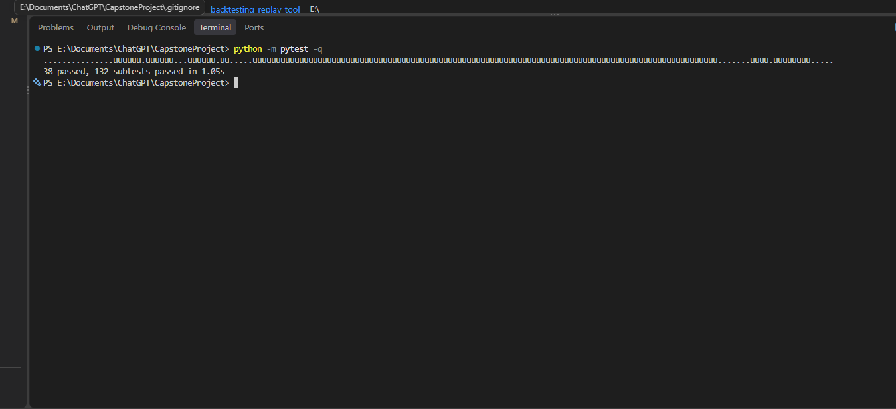
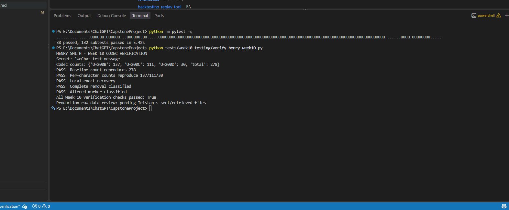

# Week 10 Henry Codec Validation and Failure-Analysis Support

**Prepared by:** Henry Smith

**Date:** October 22, 2026

**Status:** Local verification complete; production raw-data review pending

## Purpose

Support reproducible decoder verification during production testing, detect
inconsistent trial records, and classify failures without changing retrieved
platform text.

## Completed Work

- Confirmed the merged Week 9 codec and failure-analysis tests still pass.
- Reproduced the codec counts for Tristan's preliminary WeChat secret.
- Reviewed both saved WeChat result screenshots.
- Added validation for the seven approved platform-operation combinations.
- Added checks for required metadata, evidence, UTC timestamps, repetitions,
  duplicate trial IDs, and duplicate production slots.
- Added comparisons between claimed trial metrics and metrics recalculated from
  the raw sent and retrieved UTF-8 files.
- Added five automated tests for the Week 10 validator.

## Preliminary WeChat Evidence Review

The secret `WeChat test message`, encoded locally with the baseline codec,
reproduces these counts exactly:

| Character | Reproduced count |
|---|---:|
| U+200B | 137 |
| U+200C | 111 |
| U+200D | 30 |
| Total | 278 |

The local message decodes exactly. Both screenshots show the same 278 sent and
retrieved codec characters, 100% count-based retention, and exact recovery.
This supports the internal consistency of the documented feasibility result.

However, the repository does not contain the raw retrieved WeChat text files.
Therefore, Henry cannot independently rerun the decoder on the post-WeChat
sequences. These checks remain preliminary evidence and do not count toward the
approved Week 10 production total.

## Production Trial Validator

Run the validator when Tristan supplies a JSON batch and its referenced raw
UTF-8 files:

```powershell
python tests/week10_testing/validate_production_trials.py path/to/batch.json
```

Each record must include:

- trial ID, platform, operation, corpus ID, and repetition number;
- tester, UTC timestamp, codec commit, and recovery mode;
- relative paths to the sent text, retrieved text, and evidence;
- claimed sent/retrieved counts, retention percentage, decoder result,
  exact-match result, and failure category.

The validator recalculates the metrics from the raw files. A decoding failure
is a valid experimental result; a missing field, duplicate trial, unavailable
raw file, or mismatch between a claim and its measurement is a validation
error.

## Verification Results

Full suite:

```powershell
python -m pytest -q
```

Result: **38 tests and 132 subtests passed**.

Henry demonstration:

```powershell
python tests/week10_testing/verify_henry_week10.py
```

The demonstration reproduces the WeChat baseline counts, confirms local exact
recovery, and confirms classifications for complete removal and altered frame
markers.

## Screenshot Evidence

The first screenshot shows the complete regression result: 38 tests and 132
subtests passed.



The second screenshot shows all five Week 10 codec and failure-classification
checks passing. It also clearly records that production-file review is waiting
for Tristan's raw sent and retrieved files.



## Remaining Dependency

Actual Week 10 platform failures cannot be investigated until Tristan commits
the production trial logs, raw sent/retrieved text files, and evidence. Henry's
validator is ready to process them without counting preliminary tests as
production results.
