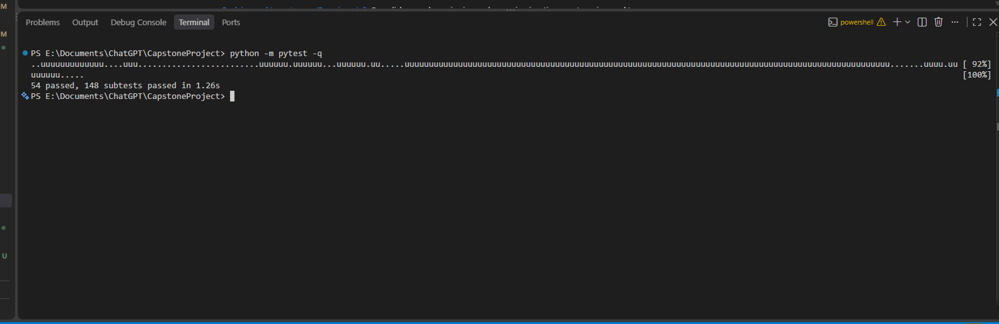
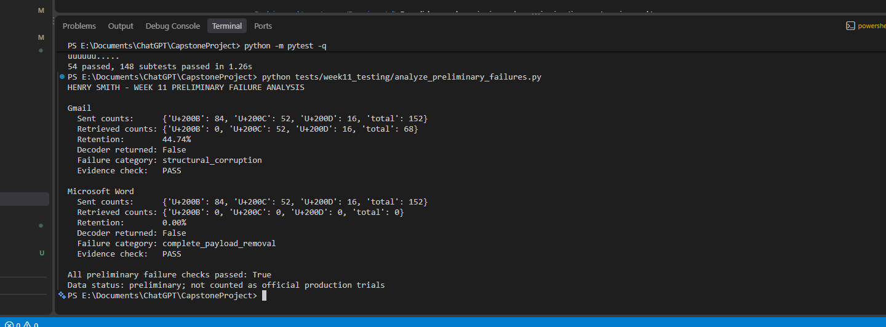
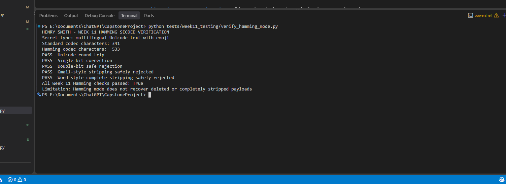

# Week 11 Henry Validation Findings

**Date:** October 27, 2026

**Scope:** Preliminary Gmail and Microsoft Word evidence plus controlled local
Hamming SECDED tests

## Gmail Finding

The committed sent file contains 84 U+200B, 52 U+200C, and 16 U+200D
characters, totaling 152. The retrieved file contains 0 U+200B, 52 U+200C,
and 16 U+200D characters, totaling 68.

- Count-based retention: 44.74%
- Decoder returned: No
- Failure category: `structural_corruption`
- Visible cover preserved: Yes
- Interpretation: Gmail removed the complete U+200B character class in this
  preliminary test. The missing bit positions make recovery unavailable.

## Microsoft Word Finding

The committed sent file contains 152 codec characters. The retrieved file
contains none of the project's three codec characters.

- Count-based retention: 0.00%
- Decoder returned: No
- Failure category: `complete_payload_removal`
- Visible cover preserved: Yes
- Interpretation: Word removed the complete invisible payload in this
  preliminary save/reopen workflow. No in-band error-correction method can
  reconstruct a payload when no encoded information survives.

## Reproduction Command

```powershell
python tests/week11_testing/analyze_preliminary_failures.py
```

The script loads the committed raw text files, recalculates the counts, runs the
decoder, verifies the expected failure categories, and labels the results as
preliminary.

## Hamming Verification Command

```powershell
python tests/week11_testing/verify_hamming_mode.py
```

This controlled demonstration verifies Unicode round trips, single-bit
correction, double-bit safe rejection, and safe rejection of the observed
Gmail-style and Word-style stripping patterns.

## Automated Test Result

```powershell
python -m pytest -q
```

Result: **54 tests and 148 subtests passed**.

## Screenshot Evidence

### Complete Automated Test Suite



This result shows that the complete project test suite finishes successfully
with 54 tests and 148 subtests passing after the optional Hamming SECDED mode
was added.

### Preliminary Gmail and Microsoft Word Failure Analysis



This result independently verifies the stored preliminary evidence. Gmail
retained 44.74% of the codec characters but produced structural corruption,
while Microsoft Word removed the full invisible payload. These are preliminary
results and are not counted as official production trials.

### Hamming SECDED Mode Verification



This result demonstrates a Unicode round trip, correction of a single altered
bit, safe rejection of a double-bit error, and safe rejection when Gmail-style
or Word-style stripping removes required payload data.

## Evidence Status

The raw preliminary sent/retrieved files and Tristan's screenshots are present
in `tests/week10_testing/preliminary_testing/`. Official production trial logs
have not yet been committed, so no production totals or platform-wide recovery
conclusions are reported here.
