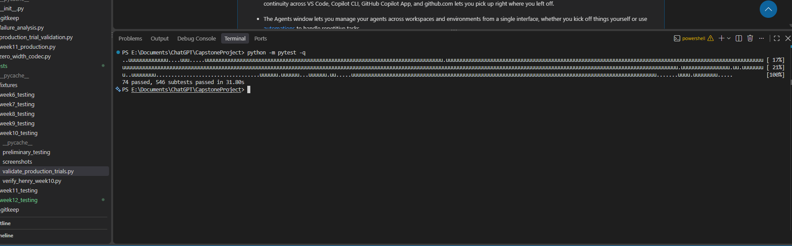
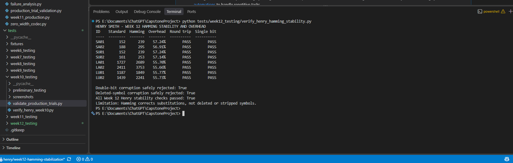

# Week 12 Hamming SECDED Stabilization

**Prepared by:** Henry Smith  
**Date:** November 4, 2026

## Scope

Week 12 stabilized the optional Hamming SECDED codec mode added in Week 11.
The work focused on regression safety, correctable and uncorrectable
corruption, false-success prevention, boundary behavior, and encoded-length
overhead. The approved eight-message corpus was used throughout.

## Stabilization Findings

- All eight corpus messages round-tripped in standard and Hamming modes.
- Hamming output remained deterministic for every corpus message.
- One altered bit in every protected codeword was corrected.
- All 78 possible two-bit combinations in a representative codeword were
  rejected as uncorrectable.
- All 286 possible three-bit combinations in a representative payload
  codeword were rejected by the complete Hamming-plus-frame validation path;
  none returned a false successful message.
- A damaged Hamming prefix and a removed codeword separator were rejected.
- A large multilingual Unicode boundary payload round-tripped successfully.
- The full regression suite passed after the new tests were added.

No unsafe decoder defect was found during this stabilization pass. The new
tests preserve the expected behavior and guard it against future regressions.

## Encoded-Length Overhead

Counts include all project codec characters: U+200B, U+200C, and U+200D.

| ID | Category | Standard characters | Hamming characters | Added overhead |
|---|---|---:|---:|---:|
| SA01 | Short ASCII | 152 | 239 | 57.24% |
| SA02 | Short ASCII | 188 | 295 | 56.91% |
| SU01 | Short Unicode | 152 | 239 | 57.24% |
| SU02 | Short Unicode | 161 | 253 | 57.14% |
| LA01 | Long ASCII | 1,727 | 2,689 | 55.70% |
| LA02 | Long ASCII | 2,411 | 3,753 | 55.66% |
| LU01 | Long Unicode | 1,187 | 1,849 | 55.77% |
| LU02 | Long Unicode | 1,439 | 2,241 | 55.73% |

The measured overhead ranges from **55.66% to 57.24%**. The percentage is
slightly higher for short messages because the two-character Hamming prefix
and frame metadata form a larger share of the encoded output. For large
messages, the result approaches the format's expected 55.56% overhead.

## Reproduction

Run Henry's focused stability tests:

```powershell
python -m pytest tests/test_hamming_stability.py -q
```

Expected result:

```text
7 passed, 398 subtests passed
```

Run the corpus-wide overhead and corruption demonstration:

```powershell
python tests/week12_testing/verify_henry_hamming_stability.py
```

Run the complete regression suite:

```powershell
python -m pytest -q
```

Verified result on November 4, 2026:

```text
74 passed, 546 subtests passed
```

## Screenshot Evidence

### Complete Regression Suite



This screenshot shows the complete project suite finishing successfully after
Henry's stabilization tests were added. It confirms that the protected-mode
changes remain compatible with the existing baseline and production-validation
tests.

### Hamming Stability and Overhead Verification



This screenshot shows the results for all eight approved corpus messages. Every
message completed its protected round trip and controlled single-bit recovery.
It also records the measured 55.66%–57.24% overhead and confirms safe rejection
of double-bit and deleted-symbol corruption.

## Limitations

Hamming SECDED protects known bit positions against substitutions. It does not
restore deleted zero-width symbols, missing separators, removed character
classes, reordered codewords, or a completely stripped payload. Those cases
are safely rejected rather than reported as successful recovery. Gmail's
official Week 11 results therefore remain unrecoverable with this mode because
Gmail removed all U+200B characters in the recorded trials.

These controlled codec tests do not replace Tristan's real-platform retests or
the team's comparative production dataset.
