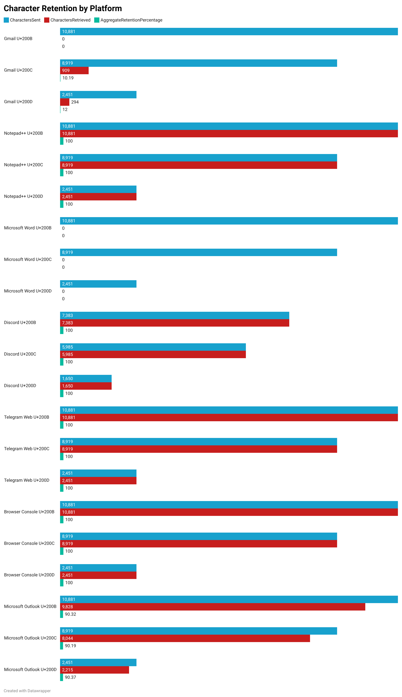
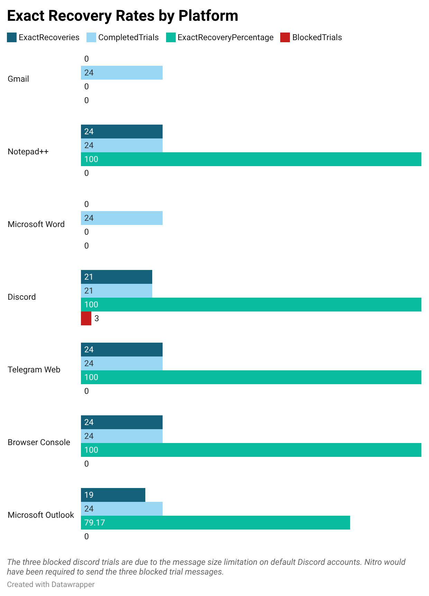
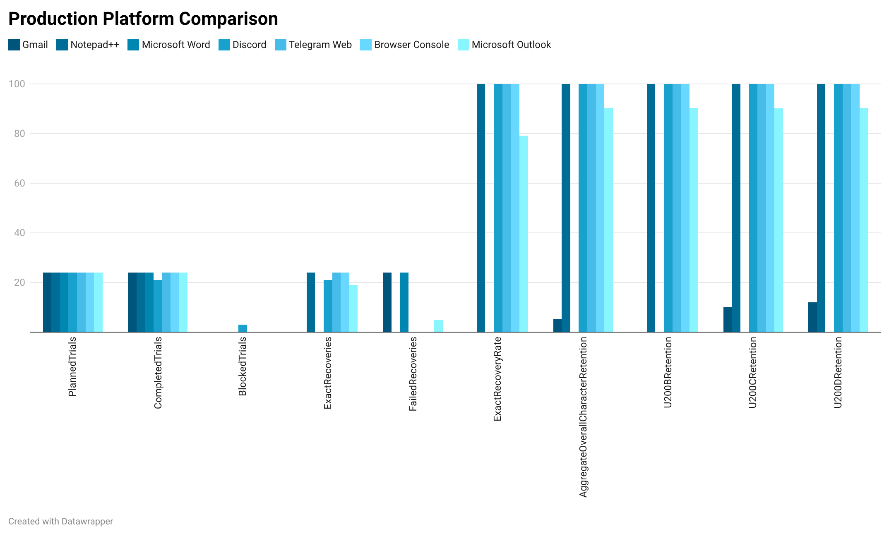
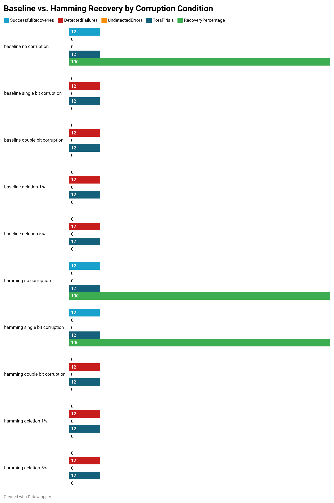
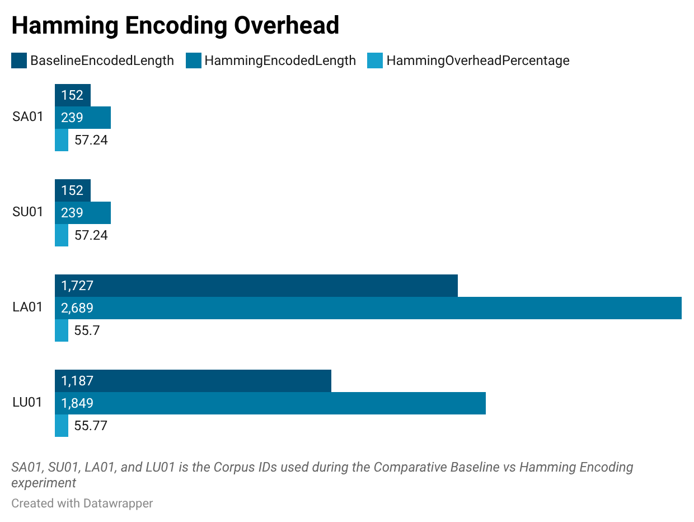

# Week 13 Results Consolidation

**Project:** CS481 Capstone Project 5 — Zero-Width Unicode Steganography with Social-Media Robustness Engineering  
**Data freeze:** November 14, 2026  
**Sources:** `tests/week11_testing/production_testing/` and `tests/week12_testing/comparative_experiment_output/`

## 1. Overview and scope

This document consolidates the official production-platform records on the Week 13 branch and the separate Week 12 Baseline-versus-Hamming experiment. Production testing contains 168 planned records across seven platforms. The comparative experiment contains 120 records across four corpus messages, two encoding methods, five corruption conditions, and three repetitions per combination.

## 2. Production-testing methodology

Each production corpus input was reused across three platform repetitions. A completed trial had an actual platform interaction and an analyzable result. A blocked trial was stopped by a documented platform limitation. Pending records remain in the trial-level CSV but are excluded from completed-trial denominators. Retention is calculated from aggregate retrieved counts divided by aggregate sent counts. Missing measurements are preserved as nulls.

## 3. Production results by platform

| Platform | Planned | Completed | Blocked | Exact | Failed | Exact recovery | Aggregate retention | Status |
|---|---:|---:|---:|---:|---:|---:|---:|---|
| Gmail | 24 | 24 | 0 | 0 | 24 | 0.00% | 5.41% | Complete |
| Notepad++ | 24 | 24 | 0 | 24 | 0 | 100.00% | 100.00% | Complete |
| Microsoft Word | 24 | 24 | 0 | 0 | 24 | 0.00% | 0.00% | Complete |
| Discord | 24 | 21 | 3 | 21 | 0 | 100.00% | 100.00% | 3 blocked |
| Telegram Web | 24 | 24 | 0 | 24 | 0 | 100.00% | 100.00% | Complete |
| Browser Console | 24 | 24 | 0 | 24 | 0 | 100.00% | 100.00% | Complete |
| Microsoft Outlook | 24 | 21 | 0 | 17 | 4 | 80.95% | 90.80% | 3 pending |

The production dataset has 162 completed trials, 110 exact recoveries, and 52 failed recoveries, for a 67.90% completed-trial exact recovery rate. Discord LA02 R1–R3 are blocked before transfer because the unchanged encoded payload exceeded the standard account message-size limit. Outlook is merged and partially validated, but SU02 R1–R3 remain `ready_for_manual_transfer`.

Gmail retained 0.00% of U+200B, 10.19% of U+200C, and 12.00% of U+200D. Its completed failures were structural or incomplete-payload failures. Microsoft Word retained none of the encoded characters. Notepad++, Telegram Web, Browser Console, and completed Discord trials retained all three symbols and recovered exactly in every completed trial. Outlook retained 90.89% U+200B, 90.67% U+200C, and 90.88% U+200D, but four completed trials still failed exact recovery.

## 4. Retention and recovery analysis

Retention and exact recovery aligned for the fully preserving platforms and for Gmail and Word, but partial retention did not guarantee exact recovery. Outlook retained most characters yet had four failed recoveries. Gmail retained some U+200C and U+200D while losing all U+200B and failing every completed decode. These results apply only to the documented workflows, corpus, and repetitions.

## 5. Blocked trials and limitations

The three Discord LA02 trials were not decoder failures: no message was sent and no retrieved payload was available. The three pending Outlook records have no measured results and are not treated as zero retention. No unverified technical cause is asserted for Outlook failures.

## 6. Separate Baseline-versus-Hamming experiment

The comparative experiment used deterministic seed pairs R1 `481201/481202`, R2 `481211/481212`, and R3 `481221/481222` for bit/deletion operations. The 120 records validate to 36 successful recoveries, 84 detected failures, and 0 undetected errors.

| Encoding | Condition | Successful | Detected failures | Undetected errors | Total | Recovery |
|---|---|---:|---:|---:|---:|---:|
| Baseline | no_corruption | 12 | 0 | 0 | 12 | 100.00% |
| Baseline | single_bit_corruption | 0 | 12 | 0 | 12 | 0.00% |
| Baseline | double_bit_corruption | 0 | 12 | 0 | 12 | 0.00% |
| Baseline | deletion_1_percent | 0 | 12 | 0 | 12 | 0.00% |
| Baseline | deletion_5_percent | 0 | 12 | 0 | 12 | 0.00% |
| Hamming | no_corruption | 12 | 0 | 0 | 12 | 100.00% |
| Hamming | single_bit_corruption | 12 | 0 | 0 | 12 | 100.00% |
| Hamming | double_bit_corruption | 0 | 12 | 0 | 12 | 0.00% |
| Hamming | deletion_1_percent | 0 | 12 | 0 | 12 | 0.00% |
| Hamming | deletion_5_percent | 0 | 12 | 0 | 12 | 0.00% |

Baseline's overall recovery rate was 20% (12/60). Hamming's was 40% (24/60). Hamming improved the tested single-bit condition but did not recover from the tested double-bit or deletion conditions. There were three repetitions per condition, so conclusions are limited to this controlled experiment.

## 7. Hamming overhead

| Corpus | Baseline length | Hamming length | Hamming overhead |
|---|---:|---:|---:|
| SA01 | 152 | 239 | 57.24% |
| SU01 | 152 | 239 | 57.24% |
| LA01 | 1727 | 2689 | 55.70% |
| LU01 | 1187 | 1849 | 55.77% |

The measured trade-off was roughly 56% additional encoded length for correction of the tested single-bit corruption. Hamming did not withstand the tested double-bit or deletion conditions.

## 8. Chart placeholders

### Chart 1 — Character Retention by Platform

 This chart compares aggregate retention for U+200B, U+200C, and U+200D across the seven tested platforms. Notepad++, completed Discord trials, Telegram Web, and Browser Console retained all three characters at 100%. Gmail retained 0.00% of U+200B, 10.19% of U+200C, and 12.00% of U+200D, while Microsoft Word retained 0% for every character. Outlook showed smaller but consistent losses across the three types, retaining 90.32% of U+200B, 90.19% of U+200C, and 90.37% of U+200D.

**Takeaway:** Platform behavior differed substantially by application, and Gmail's complete loss of U+200B was especially consequential because retention was uneven across character types. Outlook preserved most of the payload but still lost enough characters to affect exact decoding.

### Chart 2 — Exact Recovery Rate by Platform

 This chart shows exact recovery among completed trials. Notepad++, Telegram Web, Browser Console, and Discord each achieved 100% exact recovery among their completed trials: 24/24 for the first three platforms and 21/21 for Discord. Outlook recovered 19/24 trials (79.17%), while Gmail and Microsoft Word recovered 0/24. Discord's three additional planned trials were blocked before transfer and are reported separately rather than counted as failed recoveries.

**Takeaway:** Exact recovery confirms whether the preserved characters were sufficient for the original hidden message to be decoded. The results range from complete success on several platforms to no successful recovery on Gmail and Word, with Outlook showing partial compatibility.

### Chart 3 — Production Platform Comparison

 This chart combines trial status, exact recovery, and aggregate character retention for the production platforms. Across 168 planned records, 165 were completed, 112 achieved exact recovery, and 53 failed; the completed-trial recovery rate was 67.88%. Notepad++, Telegram Web, Browser Console, and completed Discord trials combined 100% retention with 100% exact recovery, whereas Gmail had 5.41% aggregate retention and 0/24 exact recoveries, and Word had 0% retention and 0/24 exact recoveries. Outlook illustrates the difference between preservation and decoding most clearly: it retained 90.27% overall but recovered exactly in 19/24 trials (79.17%).

Discord's three LA02 trials were blocked before transfer by the platform message-size limitation, so they are shown as blocked and are not included in the failed-recovery count or completed-trial denominator.

**Takeaway:** Retention is an important diagnostic, but it is not by itself equivalent to successful decoding. The comparison supports evaluating both measures while keeping platform blocks separate from decoder failures.

### Chart 4 — Baseline vs. Hamming Recovery by Corruption Condition

 This chart summarizes the separate 120-record Baseline-versus-Hamming experiment, with 12 trials for each method and corruption condition. Without corruption, both Baseline and Hamming recovered 12/12 trials (100%). Under single-bit corruption, Baseline recovered 0/12 while Hamming recovered 12/12 (100%); under double-bit corruption, approximately 1% deletion, and approximately 5% deletion, both methods recovered 0/12, with failures detected and no undetected errors.

**Takeaway:** Hamming provided a clear advantage for the tested single-bit error, but the experiment did not show protection against double-bit corruption or deletion. These findings are separate from the production-platform results and are limited to three repetitions per condition.

### Chart 5 — Hamming Encoding Overhead

 This chart compares the encoded lengths produced by Baseline and Hamming for each corpus message. Hamming increased SA01 and SU01 from 152 to 239 characters, a 57.24% overhead; LA01 increased from 1,727 to 2,689 characters, a 55.70% overhead; and LU01 increased from 1,187 to 1,849 characters, a 55.77% overhead.

**Takeaway:** Hamming's additional parity information increased encoded length by approximately 55.70%–57.24% in this corpus. That space cost supported perfect recovery under the tested single-bit corruption, so the project trade-off is improved single-bit robustness in exchange for substantially larger payloads.

## 9. Conclusions and unresolved items

The production evidence shows strong preservation in Notepad++, completed Discord trials, Telegram Web, and Browser Console; complete loss in Word; severe loss in Gmail; and partial success in Outlook. Hamming doubled the observed comparative recovery rate from 20% to 40% by correcting the tested single-bit corruption, at a measured length overhead of approximately 56%. Outlook still needs three authoritative SU02 transfer records before its planned 24-trial set is complete. The actual five chart images must be created externally and inserted at the labeled placeholders.

## 10. Reproducibility references

- Production records: `tests/week11_testing/production_testing/`
- Manifest: `tests/week11_testing/production_manifest.json`
- Comparative methodology: `docs/week12_comparative_experiment_methodology.md`
- Comparative runner and records: `tests/week12_testing/comparative_experiment.py` and `tests/week12_testing/comparative_experiment_output/`
- Consolidation script: `tests/week13_testing/consolidate_week13_results.ps1`
- Chart datasets: `tests/week13_testing/chart_data/`
