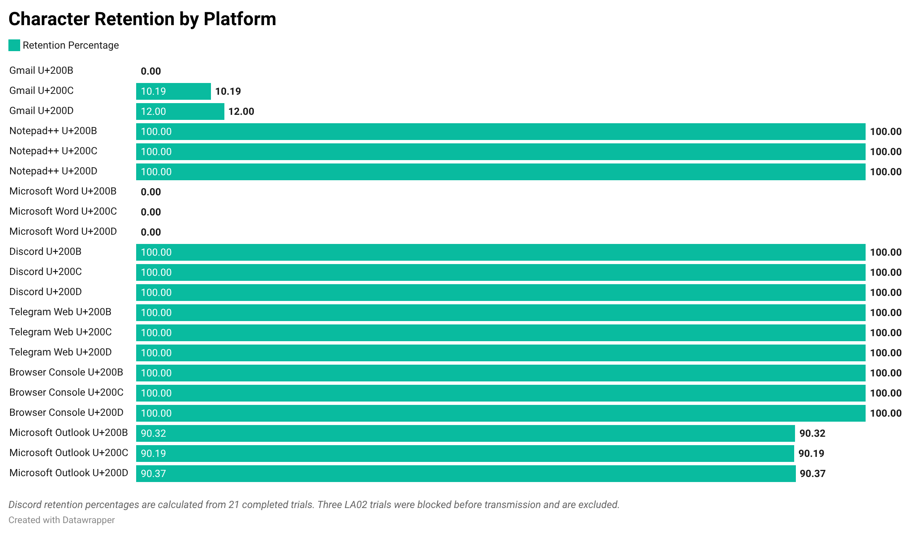
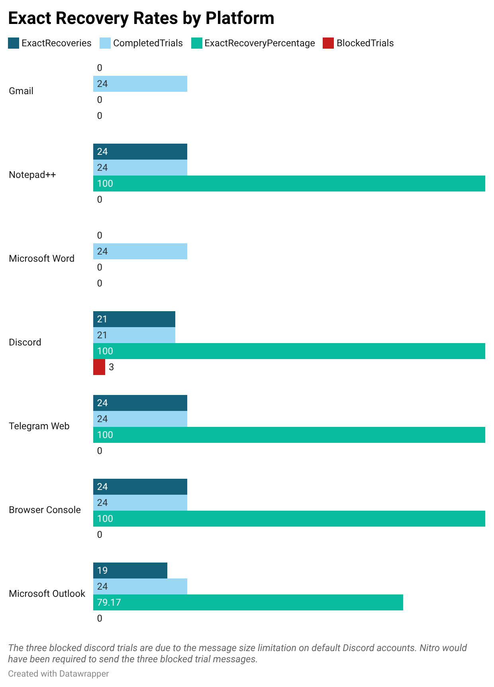
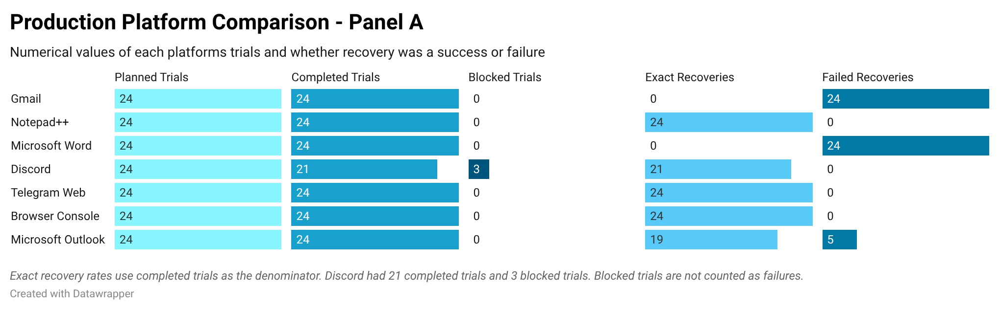
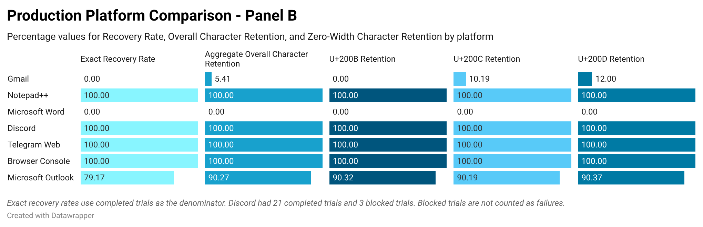
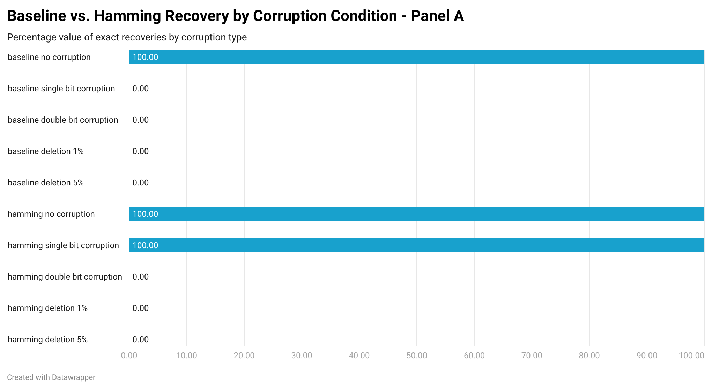
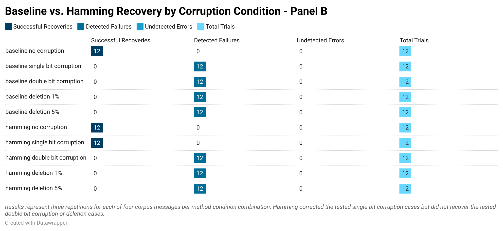
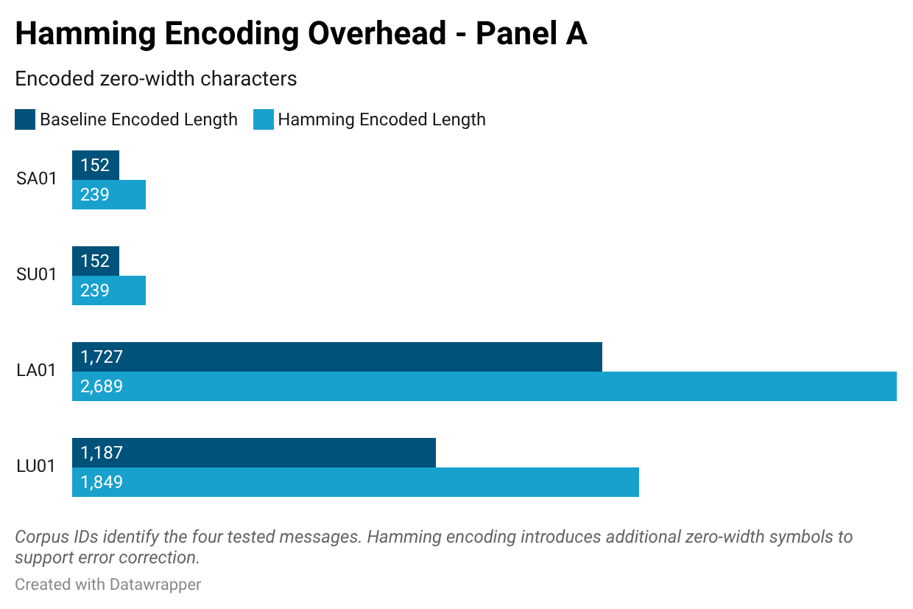
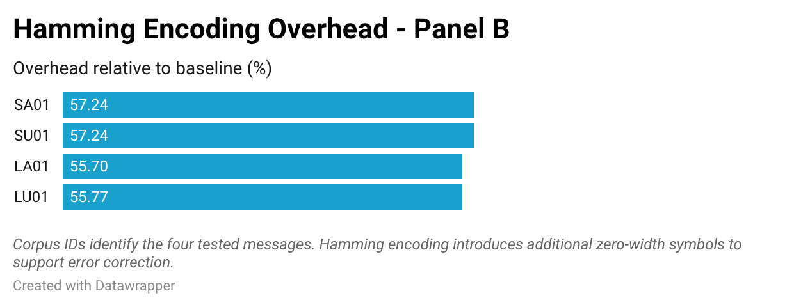

# Results

## 1. Results Overview

The final experimental evaluation consisted of two complementary evidence sets. The production-platform evaluation measured preservation and exact recovery of zero-width Unicode payloads across seven tested platforms and their documented workflows. It comprised 168 planned trials based on eight frozen corpus messages and three repetitions per message. The controlled Baseline-versus-Hamming experiment evaluated recovery after specified corruption operations across 120 locally generated trials.

The production records and the comparative experiment records were analyzed separately because they answer different questions. Production testing measured behavior after documented application workflows, whereas the comparative experiment applied deterministic corruption to encoded payloads under controlled conditions. Earlier Week 5–8 baseline, repetition, and recovery-development experiments are included below as historical development context; their results are not combined with the final production or Baseline-versus-Hamming totals.

The reported results are based on the finalized production trial JSON records, the finalized comparative Baseline-versus-Hamming JSON records, and the seven consolidated CSV files in `tests/week13_testing/chart_data/`. These source records provide the underlying trial outcomes, aggregate statistics, and chart data presented below.

Separately from the experimental trials, the latest Week 14 regression run using `python -m pytest -q` passed 87 tests and 549 subtests with no reported failures. This regression result verifies the current software test run and is not combined with the production or comparative trial totals.

## 2. Initial Codec and Recovery Development

The initial codec used a framed zero-width representation in which U+200B represented a zero bit, U+200C represented a one bit, and U+200D separated byte blocks. The frame included a format marker, UTF-8 payload length, payload bytes, and CRC-32 validation. The baseline decoder rejected malformed, incomplete, or checksum-invalid frames rather than returning unverified plaintext.

Historical Week 5 testing evaluated an optional three-copy repetition mode and established its local behavior before external-platform testing. Untouched recovery, one removed data symbol within a repeated group, and one altered data symbol within a repeated group passed the controlled checks, while removal of a separator produced a decoding failure. A separate four-scenario Week 5 corruption evaluation of the original baseline codec produced no successful recoveries under the tested removal, alteration, and combined-corruption scenarios. One important observation was that a 100% character-survival rate could still accompany decoding failure when the surviving characters had been altered.

Week 6 and Week 7 experiments then evaluated five-copy repetition under selected, distributed corruption patterns. Those experiments documented improved recovery in several controlled scenarios and failures at higher tested corruption levels. They were developmental investigations of repetition coding, not repetitions of the final Hamming experiment. The final comparative results below therefore use only the 120 individual Week 12 Baseline and Hamming records.

## 3. Production Testing Methodology

The official production dataset covered seven platform-operation combinations: Gmail, Notepad++, Microsoft Word, Discord, Telegram Web, Google Chrome Browser Console, and Microsoft Outlook. Each platform was evaluated against eight frozen corpus messages with three repetitions per message, producing 168 planned trials. The approved baseline used standard encoding with `recovery_mode=False`, and the identical encoded input for each corpus message was reused across the applicable repetitions and platforms.

A completed trial had an actual platform interaction and an analyzable retrieved result. A blocked trial was stopped by a documented platform limitation before transmission and therefore had no retrieved payload or decoder measurement. Pending records would represent trials without a completed analyzable result; the final production dataset contains no pending trials. Character retention was calculated from the aggregate number of recovered zero-width characters divided by the aggregate number sent. Exact recovery required the decoder to return the original hidden message exactly.

## 4. Production Platform Testing Results

The individual production JSON records contained 168 trials. Overall production accounting was 168 planned, 165 completed, 3 blocked, and 0 pending trials. Among completed trials, 112 recovered the hidden message exactly and 53 did not, producing a completed-trial exact-recovery rate of 67.88%.

| Platform | Planned | Completed | Blocked | Pending | Exact recoveries | Failed recoveries | Exact recovery | Aggregate retention |
|---|---:|---:|---:|---:|---:|---:|---:|---:|
| Gmail | 24 | 24 | 0 | 0 | 0 | 24 | 0.00% | 5.41% |
| Notepad++ | 24 | 24 | 0 | 0 | 24 | 0 | 100.00% | 100.00% |
| Microsoft Word | 24 | 24 | 0 | 0 | 0 | 24 | 0.00% | 0.00% |
| Discord | 24 | 21 | 3 | 0 | 21 | 0 | 100.00% of completed trials | 100.00% |
| Telegram Web | 24 | 24 | 0 | 0 | 24 | 0 | 100.00% | 100.00% |
| Google Chrome Browser Console | 24 | 24 | 0 | 0 | 24 | 0 | 100.00% | 100.00% |
| Microsoft Outlook | 24 | 24 | 0 | 0 | 19 | 5 | 79.17% | 90.27% |
| **Total** | **168** | **165** | **3** | **0** | **112** | **53** | **67.88% of completed trials** | — |

The three blocked Discord trials were LA02 repetitions R1–R3. The unchanged encoded payload exceeded the standard Discord message-size limit before transmission. Because no message was sent and no retrieved payload was available, these records were retained as blocked platform trials rather than classified as decoder failures. They were excluded from the completed-trial recovery denominator.

Microsoft Outlook completed all 24 planned trials. It produced 19 exact recoveries and five failed recoveries, corresponding to 79.17% exact recovery. Its aggregate character retention was 90.27%. The restored SU02 records are included in these totals: SU02 R1 and R2 recovered exactly with 100% retention, while SU02 R3 was a completed failed recovery with complete payload removal and 0% retention. The records do not establish a specific technical cause for the Outlook failures.

## 5. Character Retention Results

Character-level retention differed by both platform and zero-width character type. The finalized retention dataset reports aggregate counts and percentages for U+200B, U+200C, and U+200D.

| Platform | U+200B retention | U+200C retention | U+200D retention | Aggregate retention |
|---|---:|---:|---:|---:|
| Gmail | 0.00% | 10.19% | 12.00% | 5.41% |
| Notepad++ | 100.00% | 100.00% | 100.00% | 100.00% |
| Microsoft Word | 0.00% | 0.00% | 0.00% | 0.00% |
| Discord | 100.00% | 100.00% | 100.00% | 100.00% |
| Telegram Web | 100.00% | 100.00% | 100.00% | 100.00% |
| Google Chrome Browser Console | 100.00% | 100.00% | 100.00% | 100.00% |
| Microsoft Outlook | 90.32% | 90.19% | 90.37% | 90.27% |

Gmail retained the three character types unevenly: U+200B was completely absent from the retrieved payloads, while small portions of U+200C and U+200D remained. Microsoft Word retained none of the measured zero-width characters. Notepad++, completed Discord trials, Telegram Web, and Google Chrome Browser Console retained all three types. Outlook retained most of each type, with only small differences between its U+200B, U+200C, and U+200D percentages. These measurements describe the tested workflows and do not establish why an individual application processed a character type in a particular way.

*Figure 1. Aggregate retention percentages for U+200B, U+200C, and U+200D across the seven tested platforms. Discord percentages are based on 21 completed trials; its three blocked trials are excluded.*

## 6. Exact Message Recovery Results

Exact message recovery measures whether the decoder returned the original hidden message, rather than only whether zero-width characters remained in the retrieved text.

| Platform | Exact recoveries | Completed trials | Exact recovery rate | Blocked trials |
|---|---:|---:|---:|---:|
| Gmail | 0 | 24 | 0.00% | 0 |
| Notepad++ | 24 | 24 | 100.00% | 0 |
| Microsoft Word | 0 | 24 | 0.00% | 0 |
| Discord | 21 | 21 | 100.00% | 3 |
| Telegram Web | 24 | 24 | 100.00% | 0 |
| Google Chrome Browser Console | 24 | 24 | 100.00% | 0 |
| Microsoft Outlook | 19 | 24 | 79.17% | 0 |

Discord therefore achieved 21/21 exact recoveries among completed trials, not 21/24. The three additional planned trials were blocked before transmission and were not counted as failures. The results also show that character retention and exact recovery are related but distinct measurements. Outlook retained 90.27% of zero-width characters in aggregate but recovered the exact hidden message in 19 of 24 trials. Conversely, a platform can retain some characters while still failing every completed decode, as observed for Gmail.

*Figure 2. Exact recovery percentages calculated using completed trials as the denominator. Discord is 21/21 among completed trials; its three blocked trials are reported separately.*

The production comparison is shown in two complementary panels. Panel A reports planned, completed, blocked, exact-recovery, and failed-recovery counts. Panel B reports exact-recovery percentages, aggregate retention, and retention for each of the three zero-width character types.

*Figure 3. Production platform comparison. Panel A presents trial outcome counts, while Panel B presents recovery and character-retention percentages. Blocked Discord trials are platform limitations rather than failed recoveries.*

## 7. Baseline vs. Hamming Comparative Experiment Results

The controlled comparative experiment contained 120 records: four corpus messages, two encoding methods, five corruption conditions, and three repetitions per method-condition-corpus combination. The experiment recorded 36 successful recoveries, 84 detected failures, and zero undetected errors.

| Encoding method | Corruption condition | Successful recoveries | Detected failures | Undetected errors | Total trials | Recovery |
|---|---|---:|---:|---:|---:|---:|
| Baseline | No corruption | 12 | 0 | 0 | 12 | 100.00% |
| Baseline | Single-bit corruption | 0 | 12 | 0 | 12 | 0.00% |
| Baseline | Double-bit corruption | 0 | 12 | 0 | 12 | 0.00% |
| Baseline | 1% deletion | 0 | 12 | 0 | 12 | 0.00% |
| Baseline | 5% deletion | 0 | 12 | 0 | 12 | 0.00% |
| Hamming | No corruption | 12 | 0 | 0 | 12 | 100.00% |
| Hamming | Single-bit corruption | 12 | 0 | 0 | 12 | 100.00% |
| Hamming | Double-bit corruption | 0 | 12 | 0 | 12 | 0.00% |
| Hamming | 1% deletion | 0 | 12 | 0 | 12 | 0.00% |
| Hamming | 5% deletion | 0 | 12 | 0 | 12 | 0.00% |
| **Total** | — | **36** | **84** | **0** | **120** | — |

Baseline recovered all 12 no-corruption trials and none of the four tested corruption conditions. Hamming recovered all 12 no-corruption trials and all 12 single-bit-corruption trials, but none of the tested double-bit or deletion trials. Across all 60 trials for each method, Baseline achieved 20% overall recovery and Hamming achieved 40%. These results are limited to the approved corpus, three repetitions, and deterministic corruption schedules; they do not establish general performance under arbitrary platform transformations.

*Figure 4. Baseline-versus-Hamming comparative results. Panel A presents exact recovery percentages by corruption condition. Panel B presents successful recoveries, detected failures, undetected errors, and total trials. All failures in this experiment were detected.*

## 8. Hamming Encoding Overhead

Hamming encoding expanded the zero-width representation because each frame byte was protected by an extended Hamming codeword. The measured encoded lengths and overheads were:

| Corpus | Baseline encoded length | Hamming encoded length | Hamming overhead relative to Baseline |
|---|---:|---:|---:|
| SA01 | 152 | 239 | 57.24% |
| SU01 | 152 | 239 | 57.24% |
| LA01 | 1,727 | 2,689 | 55.70% |
| LU01 | 1,187 | 1,849 | 55.77% |

The overhead ranged from 55.70% to 57.24% across the four corpus messages. In the controlled comparative experiment, this additional encoded length accompanied successful correction of the tested single-bit corruption, but Hamming did not recover the tested double-bit or deletion conditions.

*Figure 5. Hamming encoding overhead. Panel A compares Baseline and Hamming encoded lengths in zero-width characters. Panel B reports overhead relative to the Baseline length.*

## 9. Summary of Experimental Findings

The final production evaluation comprised 168 planned trials, of which 165 were completed and three Discord trials were blocked before transmission. Among completed trials, 112 recovered exactly and 53 failed, yielding a 67.88% completed-trial recovery rate. Exact recovery was complete on Notepad++, Telegram Web, Google Chrome Browser Console, and completed Discord trials; Gmail and Microsoft Word produced no exact recoveries; and Outlook produced 19 exact recoveries from 24 completed trials.

The controlled 120-record comparison produced 36 successful recoveries, 84 detected failures, and no undetected errors. Baseline recovery was 20%, while Hamming recovery was 40%. Hamming corrected all tested single-bit corruption trials but did not recover the tested double-bit or deletion conditions, with an encoded-length overhead of 55.70%–57.24%. These measured findings provide the basis for the separate Evaluation section, which discusses interpretation, strengths, limitations, and future work.
