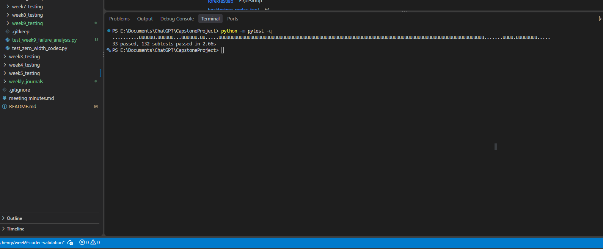
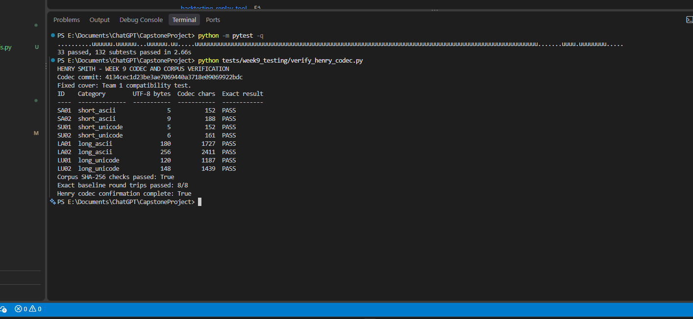

# Week 9 Henry Codec Confirmation

**Tester:** Henry Smith

**Date:** October 15, 2026

**Codec implementation commit:** `4134cec1d23be3ae7069440a3718e09069922bdc`

**Verification base commit:** `aa37928f2f026a4d6aa2e48d1c16cb25db40d40e`

## Purpose

Confirm that the baseline codec and the exact eight-message Week 9 corpus are
ready for production platform testing. This work also provides a consistent
way to classify decoder failures after a platform returns a damaged sequence.

## Fixed Baseline

- Cover text: `Team 1 compatibility test.`
- Codec mode: `recovery_mode=False`
- Corpus file: `tests/fixtures/week9_corpus.json`
- Character retention: retrieved codec-character total divided by sent
  codec-character total, multiplied by 100
- Recovery result: decoder output must exactly equal the original message

Count-based retention and exact recovery are separate measurements. Equal
counts do not prove that the same characters survived in the same order.

## Corpus Verification Results

| ID | Category | UTF-8 bytes | Codec characters | Exact local round trip |
|---|---|---:|---:|---|
| SA01 | Short ASCII | 5 | 152 | PASS |
| SA02 | Short ASCII | 9 | 188 | PASS |
| SU01 | Short Unicode | 5 | 152 | PASS |
| SU02 | Short Unicode | 6 | 161 | PASS |
| LA01 | Long ASCII | 180 | 1,727 | PASS |
| LA02 | Long ASCII | 256 | 2,411 | PASS |
| LU01 | Long Unicode | 120 | 1,187 | PASS |
| LU02 | Long Unicode | 148 | 1,439 | PASS |

All 8 corpus SHA-256 checks passed. All 8 messages encoded and decoded exactly,
preserved the visible cover, and produced deterministic output.

## Automated Verification

Command:

```powershell
python -m pytest -q
```

Result: **33 tests passed and 132 subtests passed**.

The five Week 9 diagnostic tests verify exact recovery, complete payload
removal, structural corruption, frame-marker corruption, and retention above
100 percent caused by an inserted codec character.

Corpus command:

```powershell
python tests/week9_testing/verify_henry_codec.py
```

Result: **8 of 8 exact baseline round trips passed**.

## Failure Analysis Tool

`src/failure_analysis.py` records:

- sent and retrieved codec-character counts;
- count-based retention percentage;
- values above 100 percent for investigation;
- whether the decoder returned a message;
- whether the result exactly matches the original; and
- a stable category for decoder errors.

The command-line helper is:

```powershell
python tests/week9_testing/analyze_recovered_sequence.py --sent sent.txt --retrieved retrieved.txt --secret "original secret"
```

## Screenshot Evidence

The first screenshot shows the complete automated regression result: 33 tests
and 132 subtests passed.



The second screenshot shows all eight approved corpus messages passing their
exact baseline round trips and SHA-256 checks.



## Status and Limitation

Henry's codec confirmation is complete. The team protocol remains a draft until
Ifeanyi and Tristan confirm the final platform-operation matrix and workload.
No Week 9 production platform dataset was present during this verification, so
platform-specific anomaly investigation must begin when Tristan supplies the
first retrieved samples.
