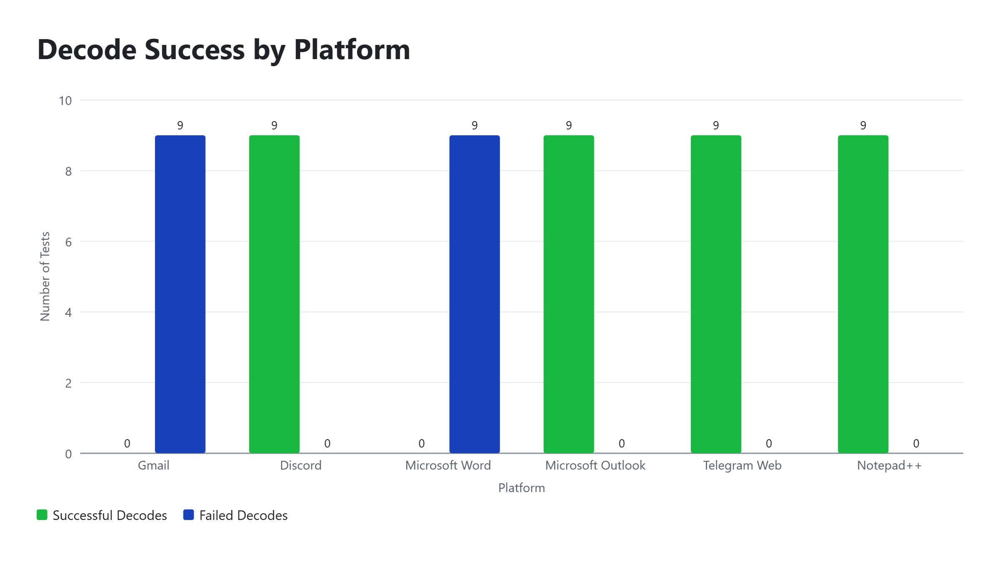

# CS481 Team 1 — Weekly Report 09

**Project:** Zero-Width Unicode Steganography with Social-Media Robustness Engineering  
**Reporting Period:** Week 9 (October 12–18, 2026)  
**Team:** Team 1

## 1. Milestones Achieved

During Week 9, our team focused on preparing for production testing, reviewing the codec implementation, and improving the quality of our testing procedures.

**Milestone 1 — Codec Verification**

Henry documented the codec implementation and verification results. The Week 9 validation branch passed 33 tests and 132 subtests. All eight approved corpus messages passed local baseline round-trip testing.

**Milestone 2 — Production Testing Protocol**

We developed a structured production testing protocol covering the approved test messages, platform workflows, trial procedures, required measurements, and supporting evidence.

**Milestone 3 — Revised Testing Scope**

Following our team meeting, I authorized a revised production testing scope as team leader to keep the project moving and meet our assignment deadline.

The revised plan covers seven platform-operation combinations, eight approved messages, and three repetitions per message, totaling 168 planned production trials.

**Milestone 4 — Data Quality Audit Preparation**

I reviewed the testing methodology and updated our Week 9 data-quality audit. The audit establishes how we will check trial completeness, character retention, decoding results, duplicate records, and unexpected platform behavior.

## 2. Subtasks Completed and Testing Evidence

### 2.1 Codec Verification

Henry documented the codec commit and verification checksum. The Week 9 validation branch passed 33 tests and 132 subtests, and all eight corpus messages completed exact local round trips.

These results confirm local baseline behavior, not successful transmission through external platforms.

**Evidence:** [Week 9 Codec Confirmation](../docs/week9_henry_codec_confirmation.md)

### 2.2 Production Testing Protocol

We documented a fixed baseline codec configuration, eight-message test corpus, platform-operation procedures, required trial fields, and evaluation metrics.

The protocol separates character retention from exact message recovery. It also requires testers to preserve unsuccessful results instead of modifying retrieved text to make decoding succeed.

**Evidence:** [Week 9 Testing Protocol](../docs/week9_testing_protocol_draft.md)

### 2.3 Testing Scope and Workload

The revised production testing plan includes:

| Measurement | Approved Plan |
|---|---|
| Platform-operation combinations | 7 |
| Approved test messages | 8 |
| Repetitions per message | 3 |
| Planned production trials | 168 |
| Week 9 target (50%) | 84 trials |

WeChat remains outside the current production scope pending access verification.

The revised scope is authorized, but the exact workflows still require final verification before production collection begins.

### 2.4 Data Quality Audit

I prepared the Week 9 audit to identify incomplete records, incorrect character counts, duplicate trials, missing evidence, and inconsistent decoding results.

The audit also requires us to report the exact recovery outcome separately from character-retention percentages.

**Evidence:** [Week 9 Data Quality Audit](../docs/week9_data_quality_audit.md)

### 2.5 Testing Screenshots and Demonstration Evidence

The Week 9 codec verification is documented in the codec confirmation file. Previous project testing screenshots are available in the repository's Week 8 evidence folder.

**Previous demonstration evidence:** [Week 8 Figures](../docs/week8_figures/)

The Week 8 screenshots demonstrate earlier testing and are not presented as evidence that the Week 9 production trials have been completed.

Week 9 production screenshots and trial logs must be added as the actual platform testing is performed.

### Previous Testing Demonstration

The following screenshots provide evidence of earlier
codec testing and recovery experiments.

**Figure 1:** Week 8 platform decoding results showing differences in successful message recovery across tested platforms. This screenshot documents earlier testing and does not represent completed Week 9 production trials.

These screenshots demonstrate previous testing only.
Week 9 production trials remain pending verification.

## 3. Lessons Learned

This week reinforced the importance of having a clear testing procedure before collecting data.

We learned that counting surviving zero-width characters is not enough to prove successful message recovery. The decoder must also return the exact original message.

We also recognized that platform operations must be tested separately because copying text into an editor is different from sending a message or saving and reopening a document.

Finally, I learned that leadership sometimes requires making timely decisions while documenting the reasons and limitations clearly.

## 4. Individual Team Contributions

**Ifeanyi — Team Leader**

- Reviewed the testing methodology and production requirements.
- Prepared and updated the Week 9 data-quality audit.
- Authorized and documented the revised production testing scope.
- Coordinated project documentation and prepared the weekly team report.
- Documented the Week 9 Monday and Friday team meetings, including attendance, project

**Henry — Codec Development and Verification**

- Documented the codec implementation commit and checksum.
- Reported successful local baseline testing.
- Confirmed the eight approved messages passed local round-trip verification.
- Provided technical evidence for the testing protocol.

**Tristan — Platform Testing and Data Collection**

- Responsible for documenting platform workflows, confirming access, and collecting production trial records.
- Production trial completion and supporting evidence remain pending verification.

Individual contributions will continue to be evaluated using documented work and GitHub commits.

## 5. Progress Compared With the Project Plan

Our team made progress in preparing the codec and testing methodology for production evaluation.

However, the Week 9 milestone requires at least 50% of the approved production trials to be completed. Under the revised 168-trial plan, this means 84 trials.

We have not yet verified that this production-testing milestone has been achieved.

To adjust our plan, we reduced the proposed scope to seven platform-operation combinations, documented the decision, and established clearer requirements for collecting and validating test results.

Our next priority is to verify the platform workflows, complete the production trials, preserve supporting screenshots and logs, and update the audit with actual measurements.

## 6. Conclusion

Week 9 focused on strengthening our project's testing foundation. We documented codec verification, improved the production testing procedure, revised the testing scope, and established data-quality requirements.

Although production testing remains pending verification, these activities provide a clearer and more consistent approach for completing the remaining work.

Our team will continue documenting actual results, maintaining individual contributions, and updating the project repository as testing progresses.