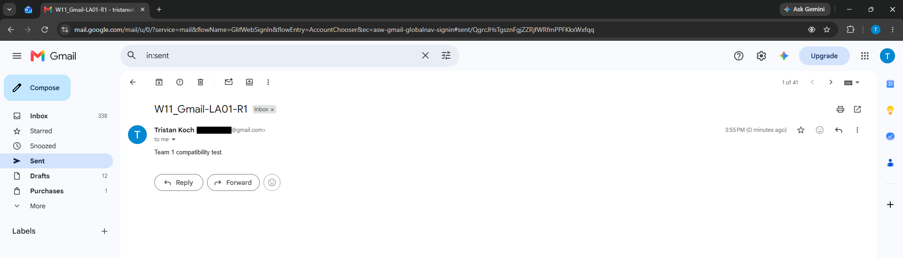
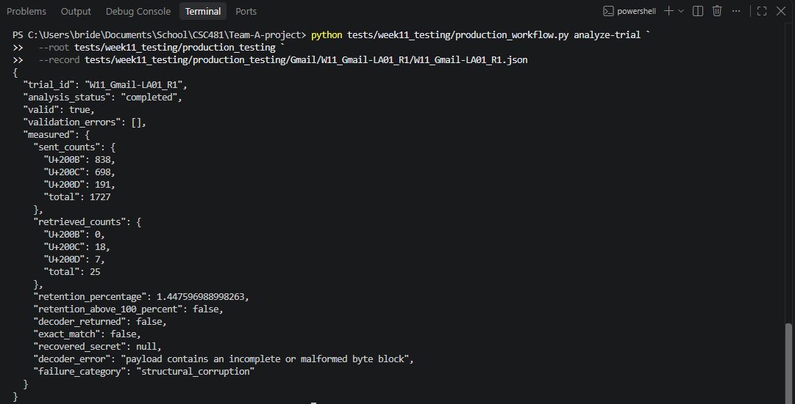

# CS481 – Team 1 Weekly Report 11

**Project:** Zero-Width Unicode Steganography with Social-Media Robustness Engineering  
**Team:** Ifeanyi Emeka (Team Leader), Tristan Koch, Henry Smith  
**Reporting Period:** October 26 – November 1, 2026  
**Status:** Week 11 deliverables partially complete: Gmail production testing (24/24 trials) and optional Hamming SECDED implementation verified and merged; other platform trials and final compatibility matrix remain outstanding.

## 1. Weekly Overview and Milestones

Week 11 combined outstanding baseline platform testing with error-correction development. The team completed the production-trial preparation workflow, conducted and reviewed all 24 planned Gmail trials, and implemented and verified an optional Hamming SECDED codec mode. All three contributions were reviewed through pull requests. The remaining six approved platform workflows, overall statistical analysis, and final compatibility matrix are not yet complete.

| Milestone | Verified Week 11 result |
|---|---|
| Production testing workflow | PR #24 merged (`8646a48`); 168 trial records prepared, **not** 168 trials performed |
| Gmail production trials | 24 of 24 recorded and reviewed; PR #26 merged (`fec9447`) |
| Hamming SECDED error correction | PR #25 merged (`3d311e7`); targeted and regression testing completed |
| Corpus integrity | 8 of 8 approved messages passed structural and SHA-256 integrity checks |
| Required meetings | Monday October 26 and Friday October 30 documented |

## 2. Individual Contributions and Subtasks

**Ifeanyi Emeka — Team Leader:** Coordinated assignments and both meetings, maintained the Week 11 audit and journal, independently checked the eight-message corpus, reviewed PRs #24–#26, reproduced automated and targeted test results, checked Gmail trial records for completeness and calculation consistency, discussed repeated SHA-256 hashes with Tristan, and merged approved work into `main`. The original pre-merge baseline produced **43 passing tests and 132 passing subtests**. The PR #24 workflow review produced **56 passing tests and 132 passing subtests**.

**Tristan Koch — Platform Testing:** Built the guarded production workflow and 168 prepared trial records in PR #24, then submitted 24 Gmail production trials with trial JSON files, original/retrieved content, screenshots, analyzer results, and a Week 11 journal in PR #26. The independent review found all 24 JSON records present, consistent retention calculations, and available referenced evidence files. All 24 records reported unsuccessful decoding. Tristan confirmed that R1, R2, and R3 were separate Gmail send-and-retrieve operations using the same encoded input, each with its own screenshot and retrieved file. Matching SHA-256 hashes across repetitions are documented for further investigation; matching hashes alone do not prove independent execution.

**Henry Smith — Codec Validation and Development:** Compared error-correction approaches, implemented optional **Hamming SECDED** mode in PR #25, documented the design and limitations, and supplied automated and targeted tests. The implementation corrects supported single-bit errors and detects double-bit errors while retaining baseline compatibility. Independent review recorded **54 passing tests and 148 passing subtests** for the full suite, **28 passing tests and 132 passing subtests** for existing codec regression tests, and **five passing targeted verification checks**. Gmail-style and Word-style stripping tests demonstrated safe rejection of unrecoverable data, **not** successful recovery after character removal.

## 3. Testing, Results, and Evidence

### 3.1 Approved Scope and Integrity Checks

The approved production scope is **seven platform-operation combinations × eight corpus messages × three independent repetitions = 168 trials**. PR #24 prepared records for all 168; prepared records must not be counted as completed external platform operations. The approved corpus in `tests/fixtures/week9_corpus.json` contained eight unique IDs with required `id`, `category`, `text`, and `sha256` fields. All eight SHA-256 integrity checks passed.

### 3.2 Gmail Production Testing

All **24 planned Gmail trials** were recorded and included in merged PR #26. Independent review checked the presence of all 24 JSON records, consistency of retention calculations with stored character counts, and availability of referenced evidence files. All 24 records reported **unsuccessful decoding**. This establishes the recorded Gmail outcome, but does not establish results for the other approved platforms.

The review noted repeated SHA-256 hashes for retrieved content across repetitions of the same corpus message. Tristan stated that each repetition was independently sent and retrieved, with distinct evidence. The hashes remain a documented data-quality question; the report does not infer independent execution from matching hashes alone.

**Representative trial — Gmail LA01, repetition 1:** The analyzer record reports **1,727 sent zero-width characters** (838 U+200B, 698 U+200C, 191 U+200D) and **25 retrieved** (0 U+200B, 18 U+200C, 7 U+200D), corresponding to approximately **1.45% retention**. The decoder did not recover the secret and classified the failure as structural corruption caused by an incomplete or malformed byte block. This example is illustrative; it is not the aggregate retention rate across 24 trials.

**Screenshot 1 — Gmail send-and-retrieve evidence**

*Explanation:* The Gmail screenshot documents the platform operation for the first repetition of the long ASCII message. The encoded message was sent through Gmail and retrieved for comparison with the original encoded input.

**Screenshot 2 — Analyzer output for the same trial**

*Explanation:* The terminal output shows 25 of 1,727 zero-width characters retained (approximately 1.45%), no exact recovery, and a structural-corruption error. The complete set of trial records and supporting evidence is maintained in the Week 11 Gmail production-testing directory referenced above.

### 3.3 Hamming Error-Correction Verification

Henry's optional Hamming SECDED implementation passed independent review and was merged in PR #25. The five targeted checks covered Unicode round-trip, single-bit correction, double-bit rejection, Gmail-style character stripping, and Word-style character stripping. The implementation can correct supported bit-level errors but cannot reconstruct a payload when a platform removes required zero-width characters. Regression results also support compatibility with the baseline codec.

**Testing limitation:** Automated codec tests, trial-record validation, and actual external platform operations are distinct evidence categories. Passing one does not establish the others.

## 4. Challenges, Lessons Learned, and Progress Against Plan

Baseline production testing originally scheduled for Week 10 carried into Week 11, delaying full statistical analysis and the compatibility matrix. The team worked on baseline evidence and error correction concurrently. Review of PR #24 reinforced the distinction between generated trial templates and completed trials; review of PR #26 reinforced the need to preserve original files, retrieved files, timestamps, screenshots, and reproducible calculations. Identical hashes across repetitions were escalated for clarification rather than dismissed or treated as proof of misconduct.

Gmail's observed loss of zero-width characters also showed why bit-error correction alone cannot guarantee recovery from platform-driven character deletion. The remaining six approved platform workflows and aggregate compatibility analysis will carry forward to Week 12.

## 5. Team Meetings and Documentation

Both required Week 11 meetings were documented:

- **Monday, October 26:** `meeting_minutes/2026-10-26_week11.md`
- **Friday, October 30:** `meeting_minutes/2026-10-30_week11.md`

All three team members attended Friday's meeting. The team reviewed Henry's Hamming implementation, Tristan's Gmail progress, evidence verification, and Week 12 responsibilities.

**Supporting project records:** `docs/week11_data_quality_audit.md`; `docs/week11_error_correction_design_review.md`; `weekly_journals/ifeanyi/week11.md`; Tristan's Week 11 journal in PR #26; GitHub PRs #24, #25, and #26; `docs/week10_henry_codec_validation.md`; and the approved protocol `docs/week9_testing_protocol_draft.md`.

## 6. Next Steps and Final Status

1. Complete and independently verify the other six approved platform workflows, retaining original/retrieved files, trial metadata, and screenshots.
2. Investigate matching retrieved-content hashes across Gmail repetitions and document any confirmed explanation.
3. Perform cross-platform statistical analysis and finalize the compatibility matrix using verified production data.
4. Evaluate Hamming SECDED against observed platform corruption and document its limitations and encoded-length overhead.
5. Continue recording individual contributions, weekly journals, and two meeting minutes per week.

**Week 11 conclusion:** The production workflow, all 24 Gmail trials, and optional Hamming SECDED implementation were reviewed and merged. The Gmail records report no successful decodes, and the Hamming implementation passed the specified automated and targeted checks. **The complete 168-trial production dataset and final compatibility matrix remain unfinished.**
