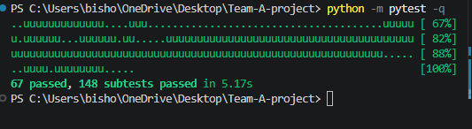
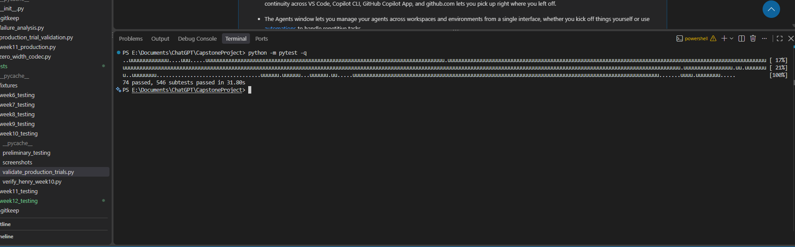
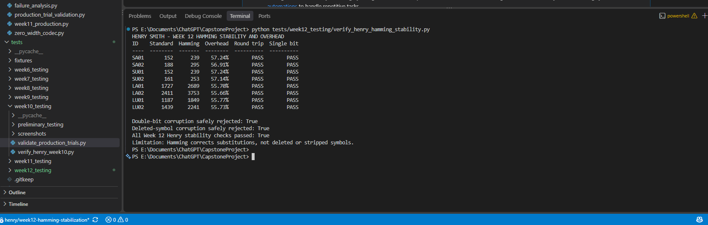
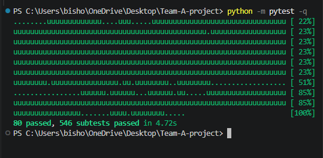

# CS481 Capstone Project
## Week 12 Progress Report

**Project:** Zero-Width Unicode Steganography and Error-Correction Evaluation  
**Team:** Team 1  
**Reporting Period:** November 2–8, 2026  
**Team Leader:** Ifeanyi Emeka  
**Team Members:** Ifeanyi Emeka, Henry Smith, Tristan Koch

---

## 1. Executive Summary

During Week 12, Team 1 stabilized the Hamming SECDED error-correction implementation, completed 72 documented production-platform trials, and finished the controlled Baseline-versus-Hamming comparative recovery experiment. The team also expanded automated regression coverage, reviewed and integrated three pull requests, and maintained the required Monday and Friday meeting records.

Henry completed Hamming stabilization and supporting verification evidence. Tristan completed the Gmail, Notepad++, and Microsoft Word production-testing submissions and the full comparative experiment. Ifeanyi coordinated the work, reviewed and merged PRs #27, #28, and #29, and independently ran regression and Hamming verification checks.

The **final integrated regression run passed 80 tests and 546 subtests** with no reported failures. The comparative experiment produced **120 individual trials**, with **36 successful recoveries, 84 detected failures, and zero undetected errors**, as documented in the submitted experiment results. Hamming recovered all 12 tested single-bit corruption cases, while Baseline recovered none; neither mode recovered the tested double-bit or deletion cases.

**Overall Week 12 status:** The planned stabilization and comparative recovery evaluation were completed and merged. Additional production-platform combinations outside the 72 documented trials remain future work.

## 2. Milestones Achieved

1. Completed Hamming SECDED stabilization and expanded regression coverage across the approved corpus.
2. Independently verified Hamming behavior and encoded-length overhead using the dedicated verification script.
3. Completed 72 documented production trials across Gmail, Notepad++, and Microsoft Word, including evidence and reproducibility instructions.
4. Completed and reviewed the initial 10-trial SA01 comparative pilot.
5. Approved and executed the full 120-trial Baseline-versus-Hamming comparative experiment with reproducible corruption conditions.
6. Produced individual comparative trial records, `summary.json`, `experiment_report.md`, methodology documentation, and automated validation tests.
7. Reviewed and merged PR #27 (Hamming stabilization), PR #28 (production testing), and PR #29 (comparative experiment) into `main`.
8. Held and documented the required Monday and Friday team meetings.
9. Completed a final integrated regression run: **80 tests and 546 subtests passed**.

## 3. Subtasks Completed

### 3.1 Hamming SECDED Stabilization — Henry Smith

Henry strengthened the protected-mode implementation and regression coverage across the eight approved corpus messages. The work addressed deterministic encoding and decoding, protected round trips, supported single-bit correction, detection or rejection of tested double-bit and three-bit corruption patterns, malformed-format handling, Unicode boundary conditions, and encoded-length overhead.

The stabilization changes and supporting documentation were integrated through **PR #27**. The dedicated verification script and screenshots remain documented in `docs/week12_henry_hamming_stability.md` and `tests/week12_testing/screenshots/henry/`.

### 3.2 Production-Platform Testing — Tristan Koch

Tristan completed 72 documented trials across three applications:

| Platform | Trials | Exact recoveries | Observed zero-width character retention |
|---|---:|---:|---|
| Gmail | 24 | 0/24 | Variable; substantial character loss |
| Notepad++ | 24 | 24/24 | 100% |
| Microsoft Word | 24 | 0/24 | 0% |
| **Total** | **72** | **24/72** | **Application-dependent** |

The results show that application handling of invisible Unicode characters directly affects recovery. Notepad++ preserved the tested payloads, while Gmail and Word did not allow exact recovery in the reported trials. The production records, screenshots, Gmail reproducibility instructions, and related documentation were integrated through **PR #28** under `tests/week11_testing/production_testing/`.

These results describe the **72 submitted trials**, not completion of every platform-operation combination in the broader production-testing plan.

### 3.3 Comparative Experiment — Tristan Koch

After the SA01 pilot was reviewed, Tristan implemented the approved full comparison. The matrix consisted of **four messages** (SA01, SU01, LA01, LU01) × **two modes** (Baseline and Hamming) × **five conditions** × **three repetitions**, producing **120 trials**.

The five conditions were: no corruption, one-bit substitution, two-bit substitution, approximately 1% zero-width symbol deletion, and approximately 5% deletion. For the bit conditions, the approved logical targets remained fixed: frame byte 9, bit 1 for single-bit corruption, and frame byte 9, bits 1 and 5 for double-bit corruption. Each mode mapped those logical coordinates to its own physical encoding positions.

The deterministic seed pairs were **R1: 481201/481202**, **R2: 481211/481212**, and **R3: 481221/481222** (bit seed/deletion seed). The bit seeds are recorded as repetition metadata; they do not change the approved fixed bit targets. Deletion seeds vary the sampling schedule across repetitions. Baseline and Hamming use the same requested deletion rates and corresponding seeds, but their different eligible symbol populations can produce different removal counts and physical positions.

Deletion eligibility includes ZERO and ONE symbols (including Hamming parity symbols), but excludes separators and the two-symbol Hamming prefix. Requested counts use nearest-integer, half-up rounding. Each record captures the applied corruption, decoder outcome, character counts, retention, and encoded-length overhead.

The experiment outputs are stored under `tests/week12_testing/comparative_experiment_output/`, with the runner at `tests/week12_testing/comparative_experiment.py` and its unit tests in `tests/test_comparative_experiment.py`. Tristan reported an additional audit comparing the 120 individual records against `summary.json` and `experiment_report.md`, with no discrepancies found. The complete submission was merged through **PR #29**.

## 4. Testing and Verification Results

### 4.1 Initial Independent Regression Testing

At the start of the reporting period, Ifeanyi ran the existing Python regression suite to establish a baseline before the Week 12 changes.

- **67 tests passed; 148 subtests passed**
- **Execution time:** 5.17 seconds
- **Reported failures:** None

*Figure 1. Initial passing regression baseline before the additional Week 12 stabilization coverage.*

### 4.2 Hamming Stabilization Regression Testing

After Henry's stabilization changes, Ifeanyi reran the full suite.

- **74 tests passed; 546 subtests passed**
- **Observed execution time:** 4.62 seconds
- **Reported failures:** None

*Figure 2. Expanded regression suite after Hamming stabilization.*

A subsequent integrated run after the earlier team PRs also passed **74 tests and 546 subtests** in 5.06 seconds. These checks supported compatibility within the behaviors covered by the automated suite.

### 4.3 Hamming Stability and Encoded-Length Overhead

Ifeanyi ran the dedicated Hamming verification script to check protected round trips, supported single-bit correction, and rejection of the tested double-bit and deleted-symbol corruption conditions. Across the approved corpus, Hamming's additional codec-character overhead was approximately **55.66%–57.24%** relative to Baseline.

*Figure 3. Dedicated Hamming stability checks and encoded-length overhead evidence.*

The additional encoded characters provide redundancy for supported bit substitutions, but do not reconstruct symbols removed from the encoded stream.

### 4.4 Production-Platform Evidence

The 72 production trials recorded sharply different application behaviors: Notepad++ retained the zero-width payload and recovered the secret in all 24 cases; Microsoft Word stripped the payload in all 24 cases; Gmail did not achieve exact recovery in its 24 cases. The per-trial records, supporting screenshots, and reproducibility notes are available under `tests/week11_testing/production_testing/`.

These manual application results are separate from the local automated regression results. Passing Python tests does not independently establish that a platform preserves invisible Unicode characters.

### 4.5 Full Comparative Recovery Results

The submitted comparative records and summary report the following outcomes:

| Corruption condition | Baseline exact recoveries | Hamming exact recoveries | Interpretation |
|---|---:|---:|---|
| No corruption | 12/12 | 12/12 | Both modes recover intact messages |
| Single-bit corruption | 0/12 | 12/12 | Hamming corrects the tested single-bit substitution |
| Double-bit corruption | 0/12 | 0/12 | Both modes detect/reject the tested corruption |
| Approximately 1% deletion | 0/12 | 0/12 | Neither mode reconstructs deleted symbols |
| Approximately 5% deletion | 0/12 | 0/12 | Neither mode reconstructs deleted symbols |
| **Total** | **12/60 (20%)** | **24/60 (40%)** | **36 successful recoveries overall** |

Across the full experiment, **84 trials were classified as detected failures**, with **zero undetected errors** and **zero unexpected execution errors** reported. Each trial was assigned exactly one outcome: `successful_recovery`, `detected_failure`, or `undetected_error`.

The comparison demonstrates a benefit for the specifically tested single-bit corruption: Hamming recovered all 12 affected trials, whereas Baseline recovered none. Its overall recovery rate was 40% compared with Baseline's 20%, at the cost of approximately 56% additional encoded characters. Neither mode recovered the tested double-bit or deletion cases. The 120-trial experiment is controlled and reproducible, but small; because bit positions were held fixed across repetitions, the results should **not** be generalized to all possible bit-error locations or real-world platforms.

**Reproduction and review evidence:** `tests/week12_testing/comparative_experiment.py`, `tests/week12_testing/comparative_experiment_output/summary.json`, the 120 individual JSON records in the same directory, `experiment_report.md`, and `tests/test_comparative_experiment.py`. The runner refuses to overwrite an existing nonempty output directory; verification should preserve the committed results rather than regenerate over them.

### 4.6 Final Integrated Regression Verification

Following the comparative experiment integration, Ifeanyi ran the full Python regression suite on the updated `main` branch. The terminal output showed:

- **80 tests passed**
- **546 subtests passed**
- **Execution time:** 4.72 seconds
- **Reported failures:** None
- **Git status:** `main` up to date with `origin/main`; working tree clean at the time of the check

*Figure 4. Final integrated regression run showing 80 passed tests and 546 passed subtests.*

The final run confirms that the integrated repository passed the automated checks available at that point. The comparative data consistency audit was reported by Tristan; the team's documented independent final check here is the regression run, not a separate recomputation of all 120 trial records by Ifeanyi.

## 5. Individual Team Contributions

### 5.1 Ifeanyi Emeka — Team Leader

- Organized and documented the Monday and Friday team meetings, assigned responsibilities, and coordinated the Week 12 deliverables.
- Independently ran the initial regression baseline, Hamming stabilization verification, and subsequent integrated regression checks.
- Reviewed the technical submissions, coordinated methodology clarification and corrections, and merged PRs #27, #28, and #29.
- Resolved a Git merge conflict while preserving report changes and maintained the team progress report and leadership journal.
- Confirmed the final integrated suite passed **80 tests and 546 subtests**, and coordinated preparation of the Week 12 submission.

### 5.2 Henry Smith — Error-Correction Development

- Stabilized the Hamming SECDED implementation and expanded automated coverage across the approved corpus.
- Added tests for supported correction, detected/rejected corruption, malformed data, and Unicode boundaries.
- Documented Hamming overhead, behavior, limitations, and reproducibility evidence.
- Reviewed the comparative pilot methodology and provided technical feedback.
- Submitted the Hamming stabilization work through **PR #27**, which was merged.

### 5.3 Tristan Koch — Production Testing and Comparative Experiments

- Completed 72 production trials across Gmail, Notepad++, and Microsoft Word, with evidence and reproducibility documentation.
- Prepared and refined the approved 10-trial SA01 comparative pilot.
- Implemented and ran the **120-trial** Baseline-versus-Hamming experiment, including deterministic seeds, fixed logical bit targets, deletion methodology, and outcome classifications.
- Generated individual JSON records, summary statistics, the experiment report, and automated validation tests.
- Reported a consistency audit of the 120 records against the summary and report, with no discrepancies.
- Submitted the production-testing work through **PR #28** and the comparative experiment through **PR #29**; both were merged.

## 6. Progress Against the Project Plan

| Planned deliverable | Week 12 status |
|---|---|
| Hamming stabilization | Completed; PR #27 merged |
| Expanded regression testing | Completed; final run 80 tests and 546 subtests passed |
| Production trials for Gmail, Notepad++, and Word | Completed; 72 documented trials, PR #28 merged |
| Comparative pilot | Completed and reviewed; 10 trial records |
| Full comparative recovery experiment | Completed; 120 trials, PR #29 merged |
| Recovery statistics and comparative analysis | Completed for the controlled 120-trial matrix |
| Encoded-length overhead analysis | Completed for the tested corpus |
| Overhead-versus-recovery-benefit discussion | Completed for tested single-bit, double-bit, and deletion conditions |
| Monday and Friday meeting minutes | Completed |
| Individual journals and team report | Updated during Week 12; final report prepared for submission |
| Remaining production platforms and operations | Not completed within these 72 reported trials; continue under the broader project plan |

The team prioritized Hamming stabilization and the approved pilot before running the full experiment. This sequencing helped avoid producing a larger dataset before agreeing on the corruption definitions, seed metadata, and validation rules.

## 7. Challenges and Lessons Learned

### 7.1 Platform Compatibility

Application behavior mattered as much as local codec correctness. Notepad++ preserved the tested invisible payloads, while Gmail and Word did not permit exact recovery in the submitted trials. Platform-specific testing is therefore necessary alongside automated codec checks.

### 7.2 Error-Correction Tradeoffs

Hamming corrected the tested single-bit substitutions, but the additional redundancy increased encoded length by roughly 56%. It did not recover the tested deleted-symbol cases. Error correction against substitution is not the same as protection against structural symbol loss.

### 7.3 Experimental Fairness and Reproducibility

The team clarified fixed logical bit targets, representation-specific physical mappings, matched seed pairs, deletion eligibility, rounding, and outcome classification before executing the full matrix. Using identical deletion percentages and seeds across modes supports a controlled comparison, while the different encoded layouts mean that deletion counts and physical positions may differ. Because bit targets stayed fixed, the three repetitions do not represent three independent bit-position samples.

### 7.4 Integration and Collaboration

Coordinating three PRs required timely technical review, clear ownership, careful version control, and resolution of a report merge conflict. Independent regression runs after integration helped confirm that the combined changes remained functional within the test suite's scope.

## 8. Remaining Work and Next Steps

The Week 12 stabilization and comparative experiment milestones are complete. The next priorities are to:

1. Preserve the merged experiment records, methodology, and regression evidence in the repository.
2. Finish any remaining production-platform combinations in the broader plan, including Discord, Telegram Web, Microsoft Outlook, and Google Chrome Browser Console, as scheduled for later work.
3. Expand the evaluation in future work to additional corruption locations and platform workflows; the Week 12 fixed-target comparison should not be treated as a broad statistical estimate.
4. Carry the validated Week 12 findings into subsequent project documentation and final presentation materials.

## 9. Team Meetings and Documentation

Both required Week 12 meetings were held and documented:

| Meeting | Date | Documentation |
|---|---|---|
| Monday planning meeting | November 2, 2026 | `meeting_minutes/2026-11-02_week12.md` |
| Friday progress meeting | November 6, 2026 | `meeting_minutes/2026-11-06_week12.md` |

All three members attended the Friday meeting. The meetings addressed testing progress, Hamming stabilization, the comparative protocol, PR coordination, documentation, and final deliverables.

## 10. Conclusion

Week 12 concluded with the Hamming stabilization, 72 documented production-platform trials, and the full 120-trial comparative recovery experiment integrated into the main repository. The final regression suite passed **80 tests and 546 subtests**. The controlled comparison recorded **36 successful recoveries, 84 detected failures, and no undetected errors**, demonstrating Hamming's advantage for the tested single-bit substitutions while also showing its overhead and limitations for deletion and double-bit corruption.

The team completed the Week 12 comparative evaluation milestone, documented the experimental method and evidence, and maintained its required meeting and contribution records. Broader platform testing and more diverse corruption scenarios remain future project work.

**Overall Week 12 Status: Completed — Core stabilization, comparative experiment, integration, and regression verification finished; broader production-platform coverage remains ongoing.**
