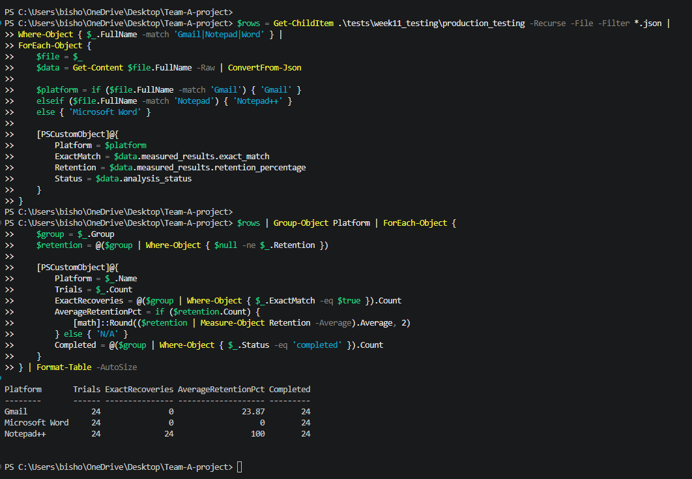

# CS481 Capstone Project — Week 13 Progress Report

**Project:** Zero-Width Unicode Steganography with Error Correction  
**Reporting Period:** November 9–15, 2026  
**Team:** Ifeanyi Emeka, Henry Smith, Tristan Koch  
**Team Leader:** Ifeanyi Emeka

## 1. Executive Summary

During Week 13, our team is focusing on finalizing experimental statistics, developing the compatibility matrix, improving code quality, and preparing reproducible analysis results.

Building on Week 12's completed comparative experiment, our goal is to verify reported results against the underlying data, document platform compatibility, and prepare the project for its next development milestone.

The team held its Monday meeting on November 9, with all three members present. Responsibilities and priorities were established according to the semester project plan.

## 2. Milestones and Progress

**Planned Milestone:** M8 — Analysis and compatibility results frozen.

Current activities include:

- Finalizing statistics and charts.
- Developing the platform compatibility matrix.
- Reviewing code quality and technical limitations.
- Verifying experimental results and supporting evidence.
- Completing any outstanding tasks from previous weeks.
- Preparing release-candidate documentation.

**Milestone Status:** In progress.

## 3. Subtasks and Individual Responsibilities

### 3.1 Ifeanyi Emeka — Team Leader

- Conducted the Monday team meeting with all members present.
- Coordinated Week 13 responsibilities and expectations.
- Began organizing the Week 13 progress report.
- Assigned responsibility for the compatibility matrix and verification activities.

**Remaining work:** Complete the compatibility matrix, review team contributions, verify results, and coordinate integration.

### 3.2 Henry Smith — Error-Correction Development

**Assigned responsibilities:**

- Review code quality and improve diagnostics.
- Document Hamming SECDED limitations and implementation constraints.
- Perform appropriate testing and provide evidence.
- Complete outstanding technical tasks.

**Status:** Awaiting verified Week 13 contributions.

### 3.3 Tristan Koch — Testing and Statistical Analysis

**Assigned responsibilities:**

- Finalize comparative experiment statistics.
- Prepare charts and reproducibility artifacts.
- Verify reported statistics against experimental records.
- Support compatibility analysis and complete outstanding testing tasks.

**Status:** Awaiting verified Week 13 contributions.

## 4. Testing and Verification Results

This section will document completed Week 13 tests, including:

- Test objectives and procedures.
- Commands or scripts executed.
- Expected and actual results.
- Screenshots embedded directly with explanations.
- Any failures, limitations, or corrective actions.

### Updated Week 13 Compatibility Verification — November 12, 2026

An independent PowerShell audit of the production-testing JSON records identified 168 planned trials across seven platforms. Of these, 150 were completed, 15 Microsoft Outlook trials remained pending manual transfer, and three Discord trials were blocked.

Among the 150 completed trials, 99 achieved exact secret recovery, representing a 66.00% exact recovery rate.

| Platform | Planned | Completed | Exact Recoveries | Pending/Blocked |
|---|---:|---:|---:|---:|
| Discord | 24 | 21 | 21 | 3 blocked |
| Gmail | 24 | 24 | 0 | 0 |
| Browser Console | 24 | 24 | 24 | 0 |
| Microsoft Outlook | 24 | 9 | 6 | 15 pending |
| Microsoft Word | 24 | 24 | 0 | 0 |
| Notepad++ | 24 | 24 | 24 | 0 |
| Telegram Web | 24 | 24 | 24 | 0 |
| **Total** | **168** | **150** | **99** | **18** |

The verification identified three blocked Discord LA02 trials and 15 Microsoft Outlook trials with `ready_for_manual_transfer` status. No other incomplete records were identified.

These findings are based on the recorded production-testing results. They describe the tested application workflows and should not be interpreted as universal compatibility guarantees.

The remaining Outlook trials will be incorporated into the final statistics after testing, analysis, and evidence verification are completed.

### Platform Compatibility Verification

A total of 72 production-testing JSON records were
independently analyzed to verify platform compatibility.

| Platform | Trials | Exact Recoveries | Average Retention |
|---|---:|---:|---:|
| Gmail | 24 | 0 | 23.87% |
| Microsoft Word | 24 | 0 | 0% |
| Notepad++ | 24 | 24 | 100% |

*Figure: PowerShell verification of 72 production-testing
records across Gmail, Microsoft Word, and Notepad++.

The compatibility analysis confirmed that Notepad++ successfully preserved the encoded zero-width characters and recovered the original secret in all 24 trials. Gmail retained an average of 23.87% of the encoded characters, but none of its 24 trials achieved exact recovery. Microsoft Word showed 0% character retention and no successful recoveries. All 72 records were marked as completed. These results demonstrate that compatibility depends on the tested application and operation, and they are limited to the documented testing conditions.

## 5. Platform Compatibility Matrix

The compatibility matrix will consolidate documented application behavior, zero-width character retention, payload recovery, and identified limitations.

Results will be based on existing validated production-testing records and additional verified evidence where available.

**Status:** In progress.

## 6. Team Meetings and Coordination

### Monday, November 9, 2026

**Attendance:** All three team members present.

The team reviewed project progress, established Week 13 responsibilities, and discussed outstanding work and expected deliverables.

**Meeting record:** `meeting_minutes/2026-11-09_week13.md`

### Friday, November 13, 2026

**Status:** Scheduled.

Meeting outcomes, attendance, and decisions will be documented after the meeting.

## 7. Challenges and Lessons Learned

To be completed based on actual Week 13 development, testing, integration, and verification activities.

## 8. Progress Against the Semester Plan

Week 13 focuses on the planned compatibility matrix, final statistics, reproducible analysis, and release-candidate preparation.

The team will evaluate progress against the semester plan and document any adjustments required.

**Overall Status:** In progress.

## 9. Next Steps

- Complete assigned Week 13 technical work.
- Review and integrate submitted pull requests.
- Verify testing evidence and experimental statistics.
- Conduct and document Friday's team meeting.
- Update individual journals and finalize the weekly report.
- Submit the GitHub repository URL by Sunday, November 15, at 11:59 PM.

## 10. Conclusion

Week 13 work is underway, with responsibilities assigned and the reporting structure established. Final results, testing evidence, and milestone status will be updated as contributions are completed and verified.