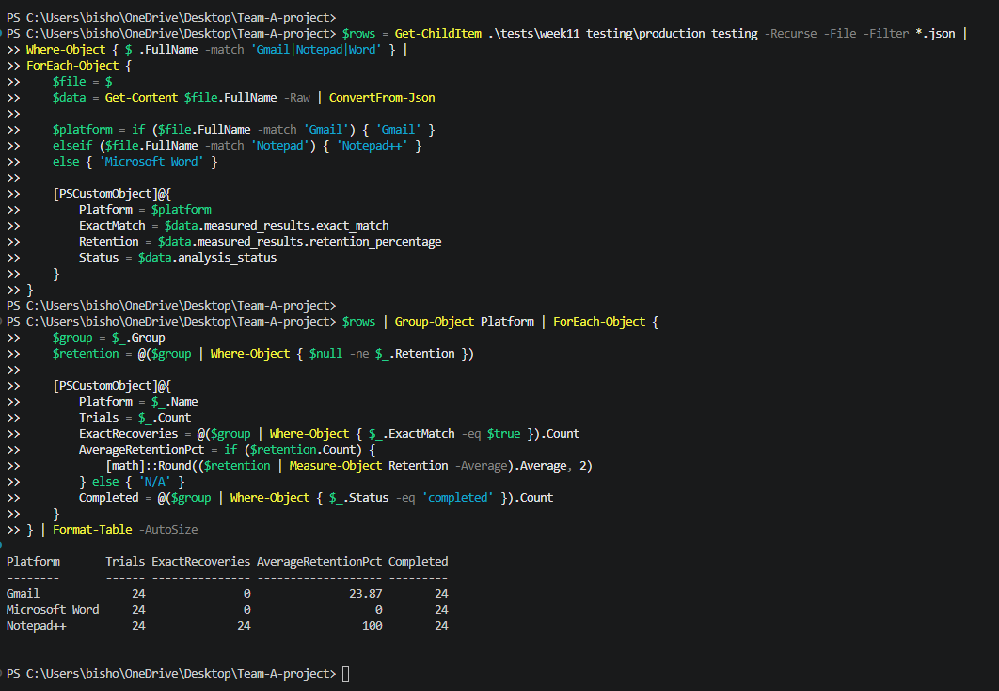

# CS481 Capstone Project — Week 13 Progress Report

**Project:** Zero-Width Unicode Steganography with Error Correction  
**Reporting Period:** November 9–15, 2026  
**Team:** Ifeanyi Emeka, Henry Smith, Tristan Koch  
**Team Leader:** Ifeanyi Emeka

## 1. Executive Summary

During Week 13, our team is focusing on finalizing experimental statistics, developing the compatibility matrix, improving code quality, and preparing reproducible analysis results.

Building on Week 12's completed comparative experiment, our goal is to verify reported results against the underlying data, document platform compatibility, and prepare the project for its next development milestone.

The team held its Monday meeting on November 9, with all three members present. Responsibilities and priorities were established according to the semester project plan.

## 2. Milestones and Progress

**Planned Milestone:** M8 — Analysis and compatibility results frozen.

Current activities include:

- Finalizing statistics and charts.
- Developing the platform compatibility matrix.
- Reviewing code quality and technical limitations.
- Verifying experimental results and supporting evidence.
- Completing any outstanding tasks from previous weeks.
- Preparing release-candidate documentation.

**Milestone Status:** Results consolidation, compatibility verification, and chart preparation complete; final submission review remains.

## 3. Subtasks and Individual Responsibilities

### 3.1 Ifeanyi Emeka — Team Leader

- Conducted the Monday team meeting with all members present.
- Coordinated Week 13 responsibilities and expectations.
- Began organizing the Week 13 progress report.
- Assigned responsibility for the compatibility matrix and verification activities.

**Remaining work:** Complete any final team review and submission coordination.

### 3.2 Henry Smith — Error-Correction Development

**Assigned responsibilities:**

- Review code quality and improve diagnostics.
- Document Hamming SECDED limitations and implementation constraints.
- Perform appropriate testing and provide evidence.
- Complete outstanding technical tasks.

**Status:** Contribution status is documented in the merged team records and supporting Week 13 evidence.

### 3.3 Tristan Koch — Testing and Statistical Analysis

**Assigned responsibilities:**

- Finalize comparative experiment statistics.
- Prepare charts and reproducibility artifacts.
- Verify reported statistics against experimental records.
- Support compatibility analysis and complete outstanding testing tasks.

**Status:** Statistics, chart datasets, chart images, and results documentation completed and independently checked.

## 4. Testing and Verification Results

This section documents completed Week 13 tests, including:

- Test objectives and procedures.
- Commands or scripts executed.
- Expected and actual results.
- Screenshots embedded directly with explanations.
- Any failures, limitations, or corrective actions.

### Updated Week 13 Compatibility Verification — November 12, 2026

An independent PowerShell audit of the production-testing JSON records identified 168 planned trials across seven platforms. Of these, 165 were completed and three Discord trials were blocked before transfer. No production trials remain pending.

Among the 165 completed trials, 112 achieved exact secret recovery, representing a 67.88% exact recovery rate.

| Platform | Planned | Completed | Exact Recoveries | Blocked | Failed |
|---|---:|---:|---:|---:|---:|
| Discord | 24 | 21 | 21 | 3 | 0 |
| Gmail | 24 | 24 | 0 | 0 | 24 |
| Browser Console | 24 | 24 | 24 | 0 | 0 |
| Microsoft Outlook | 24 | 24 | 19 | 0 | 5 |
| Microsoft Word | 24 | 24 | 0 | 0 | 24 |
| Notepad++ | 24 | 24 | 24 | 0 | 0 |
| Telegram Web | 24 | 24 | 24 | 0 | 0 |
| **Total** | **168** | **165** | **112** | **3** | **53** |

The verification identified three blocked Discord LA02 trials. The restored Outlook SU02 records are completed: R1 and R2 recovered exactly, while R3 was a completed failed recovery with complete payload removal.

These findings are based on the recorded production-testing results. They describe the tested application workflows and should not be interpreted as universal compatibility guarantees.

The final statistics include all 24 Outlook records.

### Platform Compatibility Verification

A prior subset of 72 production-testing JSON records was independently analyzed during the earlier Week 13 verification.

| Platform | Trials | Exact Recoveries | Average Retention |
|---|---:|---:|---:|
| Gmail | 24 | 0 | 23.87% |
| Microsoft Word | 24 | 0 | 0% |
| Notepad++ | 24 | 24 | 100% |

*Figure: Earlier PowerShell verification of 72 production-testing
records across Gmail, Microsoft Word, and Notepad++.*

That earlier subset confirmed that Notepad++ successfully preserved the encoded zero-width characters and recovered the original secret in all 24 trials. The final seven-platform audit supersedes its aggregate totals: Gmail's final aggregate retention is 5.41% with no exact recoveries, Microsoft Word has 0% retention with no exact recoveries, and Outlook has 19/24 exact recoveries with 90.27% aggregate retention. These results demonstrate that compatibility depends on the tested application and operation, and they are limited to the documented testing conditions.

## 5. Platform Compatibility Matrix

The compatibility matrix consolidates documented application behavior, zero-width character retention, payload recovery, and identified limitations.

Results will be based on existing validated production-testing records and additional verified evidence where available.

**Status:** Complete for the current seven-platform production dataset; three Discord LA02 trials remain blocked by the platform message-size limitation.

## 6. Team Meetings and Coordination

### Monday, November 9, 2026

**Attendance:** All three team members present.

The team reviewed project progress, established Week 13 responsibilities, and discussed outstanding work and expected deliverables.

**Meeting record:** `meeting_minutes/2026-11-09_week13.md`

### Friday, November 13, 2026

**Status:** No Week 13 Friday meeting minutes were found in the repository. Attendance, outcomes, and decisions are therefore not asserted here.

## 7. Challenges and Lessons Learned

The final audit required reconciling a large set of individual JSON records, screenshots, and derived datasets without treating blocked trials as decoder failures. The restored Outlook SU02 records required rechecking the earlier partial Outlook totals: SU02 R1 and R2 recovered exactly, while R3 was a completed failed recovery with complete payload removal. The production results further showed that character retention and exact recovery are related but not interchangeable, since Outlook retained 90.27% of the payload but recovered exactly in 19 of 24 trials. The three Discord LA02 trials remained blocked before transfer because the unchanged payload exceeded the standard account message-size limit.

## 8. Progress Against the Semester Plan

Week 13 focused on the planned compatibility matrix, final statistics, reproducible analysis, chart preparation, and release-candidate documentation. The final production dataset and separate comparative experiment were reconciled against their individual source records, and the five chart images were checked against the final CSV datasets.

**Overall Status:** Results and compatibility documentation complete; final submission coordination remains.

## 9. Next Steps

- Complete final review of testing evidence, experimental statistics, and chart placement.
- Review and integrate any remaining team feedback.
- Keep any remaining team-review documentation synchronized with the final verified totals.
- Submit the GitHub repository URL by Sunday, November 15, at 11:59 PM.

## 10. Conclusion

Week 13 results, testing evidence, compatibility documentation, chart datasets, and chart images have been consolidated and checked against the underlying records. Final submission coordination remains.
