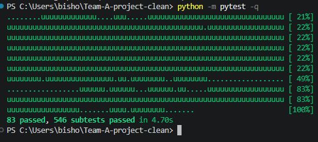

# CS481 Capstone Project — Week 13 Progress Report

**Project:** Zero-Width Unicode Steganography with Error Correction  
**Reporting Period:** November 9–15, 2026  
**Team:** Ifeanyi Emeka, Henry Smith, Tristan Koch  
**Team Leader:** Ifeanyi Emeka

## 1. Executive Summary

During Week 13, our team focused on completing the platform compatibility matrix, finalizing experimental statistics, improving code quality, and preparing reproducible analysis documentation.

All three members contributed to the project. Henry completed the remaining Microsoft Outlook testing and code-quality improvements, Tristan consolidated the final results and generated statistical charts, and I coordinated the work, verified compatibility records, updated documentation, and performed final regression testing.

We held both required team meetings on Monday, November 9, and Friday, November 13, with all three members present.

The final regression test suite passed with **83 tests and 546 subtests successful**.

## 2. Milestones and Progress

**Planned Milestone:** M8 — Analysis and compatibility results frozen.

The team completed the following:

- Finalized the platform compatibility matrix.
- Consolidated production-testing and comparative-experiment statistics.
- Generated five charts and supporting CSV datasets.
- Completed outstanding Outlook testing and documented the results.
- Improved code quality and added testing evidence.
- Merged the Week 13 contributions into the main branch.
- Successfully executed the final regression test suite.

**Milestone Status:** Results consolidation, compatibility verification, and chart preparation complete; final submission review remains.
**Milestone Status:** Analysis and compatibility documentation completed. Release-candidate readiness remains subject to the remaining release checks.

## 3. Subtasks and Individual Contributions

### 3.1 Ifeanyi Emeka — Team Leader

- Conducted the Monday team meeting with all members present.
- Coordinated Week 13 responsibilities and expectations.
- Began organizing the Week 13 progress report.
- Assigned responsibility for the compatibility matrix and verification activities.

**Remaining work:** Complete any final team review and submission coordination.
- Conducted and documented the Monday and Friday meetings.
- Coordinated team responsibilities and deadlines.
- Independently verified production-testing JSON records using PowerShell.
- Updated the compatibility matrix and Week 13 progress report.
- Reviewed team contributions and synchronized the repository.
- Executed the final regression tests after integrating the Week 13 changes.
- Documented testing evidence and prepared the final weekly submission.

### 3.2 Henry Smith — Error-Correction Development and Testing

- Completed the remaining Microsoft Outlook production-testing work.
- Added testing results, screenshots, and supporting documentation.
- Reported 11 successful trials with 100% retention and exact recovery during the remaining Outlook testing.
- Documented one delivery failure in which the email did not arrive in the receiving inbox.
- Completed code-quality improvements and additional testing.
- Submitted changes that were merged into the main branch.

The delivery failure was documented separately from a codec failure because the exact cause could not be confirmed.
### 3.2 Henry Smith — Error-Correction Development

**Assigned responsibilities:**

- Review code quality and improve diagnostics.
- Document Hamming SECDED limitations and implementation constraints.
- Perform appropriate testing and provide evidence.
- Complete outstanding technical tasks.

**Status:** Contribution status is documented in the merged team records and supporting Week 13 evidence.

### 3.3 Tristan Koch — Statistical Analysis and Documentation

- Consolidated the completed production-testing and comparative-experiment results.
- Generated supporting CSV datasets and five statistical charts.
- Updated the compatibility matrix, results documentation, and weekly progress report.
- Verified reported totals and chart references against the consolidated data.
- Completed his Week 13 individual journal.
- Submitted the final results-documentation pull request, which was merged into the main branch.

## 4. Testing and Verification Results

This section documents completed Week 13 tests, including:

- Test objectives and procedures.
- Commands or scripts executed.
- Expected and actual results.
- Screenshots embedded directly with explanations.
- Any failures, limitations, or corrective actions.

### Updated Week 13 Compatibility Verification — November 12, 2026

An independent PowerShell audit of the production-testing JSON records identified 168 planned trials across seven platforms. Of these, 165 were completed and three Discord trials were blocked before transfer. No production trials remain pending.

Among the 165 completed trials, 112 achieved exact secret recovery, representing a 67.88% exact recovery rate.

| Platform | Planned | Completed | Exact Recoveries | Blocked | Failed |
|---|---:|---:|---:|---:|---:|
| Discord | 24 | 21 | 21 | 3 | 0 |
| Gmail | 24 | 24 | 0 | 0 | 24 |
| Browser Console | 24 | 24 | 24 | 0 | 0 |
| Microsoft Outlook | 24 | 24 | 19 | 0 | 5 |
| Microsoft Word | 24 | 24 | 0 | 0 | 24 |
| Notepad++ | 24 | 24 | 24 | 0 | 0 |
| Telegram Web | 24 | 24 | 24 | 0 | 0 |
| **Total** | **168** | **165** | **112** | **3** | **53** |

The verification identified three blocked Discord LA02 trials. The restored Outlook SU02 records are completed: R1 and R2 recovered exactly, while R3 was a completed failed recovery with complete payload removal.

These findings are based on the recorded production-testing results. They describe the tested application workflows and should not be interpreted as universal compatibility guarantees.

The final statistics include all 24 Outlook records.

### 4.2 Platform Compatibility Verification

A prior subset of 72 production-testing JSON records was independently analyzed during the earlier Week 13 verification.

| Platform | Trials | Exact Recoveries | Average Retention |
|---|---:|---:|---:|
| Gmail | 24 | 0 | 23.87% |
| Microsoft Word | 24 | 0 | 0% |
| Notepad++ | 24 | 24 | 100% |

*Figure: Earlier PowerShell verification of 72 production-testing
records across Gmail, Microsoft Word, and Notepad++.*

That earlier subset confirmed that Notepad++ successfully preserved the encoded zero-width characters and recovered the original secret in all 24 trials. The final seven-platform audit supersedes its aggregate totals: Gmail's final aggregate retention is 5.41% with no exact recoveries, Microsoft Word has 0% retention with no exact recoveries, and Outlook has 19/24 exact recoveries with 90.27% aggregate retention. These results demonstrate that compatibility depends on the tested application and operation, and they are limited to the documented testing conditions.
*Figure 1: PowerShell verification of 72 production-testing records across Gmail, Microsoft Word, and Notepad++.*

Notepad++ preserved the encoded characters and recovered the original secret in all 24 trials. Gmail retained an average of 23.87% of encoded characters but produced no exact recoveries. Microsoft Word showed no character retention or exact recoveries in the tested workflows.

### 4.3 Comparative Experiment Results

The comparative experiment contained 120 records.

| Metric | Result |
|---|---:|
| Total records | 120 |
| Successful recoveries | 36 |
| Detected failures | 84 |
| Undetected errors | 0 |

Tristan consolidated these results and prepared charts covering character retention, exact recovery rates, platform comparisons, baseline versus Hamming results, and Hamming encoding overhead.

The analysis files, CSV datasets, and charts are included in the repository's Week 13 testing documentation.

### 4.4 Final Regression Testing

After merging the Week 13 contributions, the complete regression test suite was executed using:

`python -m pytest -q`

**Results:**

- 83 tests passed.
- 546 subtests passed.
- Execution time: 4.70 seconds.
- No test failures were reported.

*Figure 2: Final regression testing after integrating the Week 13 team contributions.*

The successful regression test confirmed that the integrated changes passed the project's existing automated tests.

## 5. Platform Compatibility Matrix

The Week 13 compatibility matrix was updated to reflect the consolidated production-testing results across seven platforms.

The matrix documents completed trials, exact recovery outcomes, character retention where measured, blocked cases, and testing limitations.
The compatibility matrix consolidates documented application behavior, zero-width character retention, payload recovery, and identified limitations.

The results demonstrate that successful recovery depends on how each application processes and preserves zero-width Unicode characters.

**Status:** Completed and updated with the final consolidated results.

## 6. Team Meetings and Coordination

### Monday, November 9, 2026

**Attendance:** All three team members present.

The team reviewed Week 12 progress, established Week 13 responsibilities, and discussed outstanding testing, documentation, and verification requirements.

**Meeting record:** `meeting_minutes/2026-11-09_week13.md`

### Friday, November 13, 2026

**Attendance:** All three team members present.

The Friday meeting was held, and the team's Week 13 work and finalization requirements were documented in the meeting minutes.

**Meeting record:** `meeting_minutes/2026-11-13_week13.md`

## 7. Challenges and Lessons Learned

The final audit required reconciling a large set of individual JSON records, screenshots, and derived datasets without treating blocked trials as decoder failures. The restored Outlook SU02 records required rechecking the earlier partial Outlook totals: SU02 R1 and R2 recovered exactly, while R3 was a completed failed recovery with complete payload removal. The production results further showed that character retention and exact recovery are related but not interchangeable, since Outlook retained 90.27% of the payload but recovered exactly in 19 of 24 trials. The three Discord LA02 trials remained blocked before transfer because the unchanged payload exceeded the standard account message-size limit.
One challenge involved completing the remaining Microsoft Outlook production tests. Henry assisted with the testing and documented the outcomes, including a delivery failure whose exact cause could not be confirmed.

Another challenge was ensuring that reported statistics accurately reflected the underlying experimental records. Independent verification and consolidated analysis helped the team distinguish completed, blocked, and successful trials.

We also reinforced the importance of maintaining supporting screenshots, documenting limitations, and verifying the integrated software after merging contributions.

## 8. Progress Against the Semester Plan

Week 13 focused on the planned compatibility matrix, final statistics, reproducible analysis, chart preparation, and release-candidate documentation. The final production dataset and separate comparative experiment were reconciled against their individual source records, and the five chart images were checked against the final CSV datasets.

The team completed the principal analysis and documentation deliverables. The final production-testing results were consolidated, supporting charts were generated, and the automated regression suite passed.

**Overall Status:** Week 13 analysis and documentation completed. Any remaining release-candidate checks will be handled separately.

## 9. Next Steps

- Complete final review of testing evidence, experimental statistics, and chart placement.
- Review and integrate any remaining team feedback.
- Keep any remaining team-review documentation synchronized with the final verified totals.
- Submit the GitHub repository URL by Sunday, November 15, at 11:59 PM.
- Complete any outstanding release-candidate verification requirements.
- Confirm documentation links and supporting evidence remain accessible.
- Continue preparing the final project deliverables.
- Submit the Week 13 GitHub repository URL by Sunday, November 15, at 11:59 PM.

## 10. Conclusion

Week 13 was a productive week for Team A. We completed the remaining production-testing work, finalized the compatibility analysis, consolidated experimental results, and improved the project documentation.

Each member contributed to the final deliverables, and the integrated project passed all 83 automated tests and 546 subtests.

The team is prepared to submit its Week 13 progress and continue toward the final project deliverables.