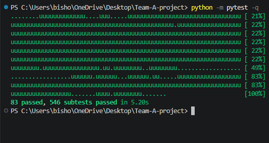

# CS481 Capstone Project — Week 14 Progress Report

**Project:** Zero-Width Unicode Steganography with Error Correction  
**Team:** Team A  
**Week:** 14 (November 16–22, 2026)  
**Team Members:** Ifeanyi Emeka, Henry Smith, Tristan Koch

## 1. Milestones Achieved

Week 14 focuses on completing outstanding development tasks, verifying the integrated software, improving documentation, and preparing for the final project report and presentation.

**Confirmed progress:**
- Conducted the Monday, November 16, team meeting with all three members present.
- Established code completion, testing, and documentation as the team's immediate priorities.
- Documented and uploaded the Monday meeting minutes to GitHub.

**Additional milestones:** To be updated as work is completed and verified.

## 2. Subtasks Completed

### 2.1 Team Coordination

The team met on Monday, November 16, to discuss Week 14 priorities, outstanding issues, testing, and readiness for the final report and presentation.

### 2.2 Development and Documentation

Development changes, documentation updates, and completed pull requests will be recorded here after verification.

## 3. Individual Contributions

### 3.1 Ifeanyi Emeka — Team Leader

- Coordinated the Monday team meeting.
- Documented and committed the Week 14 Monday meeting minutes.
- Established the initial Week 14 reporting structure.
- Continued coordinating project integration, testing, and documentation.

### 3.2 Henry Smith — Error-Correction Development

**Week 14 contributions:** Pending verification of completed work and commits.

### 3.3 Tristan Koch — Testing and Statistical Analysis

**Week 14 contributions:** Pending verification of completed work and commits.

## 4. Testing and Verification Results

This section will document the Week 14 testing performed on the integrated project.

For each test, record:
- The command or procedure used.
- The purpose of the test.
- The actual results.
- Any failures or limitations.
- A screenshot with an explanation.

Henry Smith — Final Code-Quality Verification

Henry completed his Week 14 code-quality review, documentation, automated quality tests, and codec verification script. His contribution was reviewed and integrated into the main branch.

The verification script passed all five codec checks, including baseline and repetition backward compatibility, Hamming Unicode round-trip, single-bit correction, and double-bit detection.

Following integration, the full regression suite passed 87 tests and 549 subtests in 5.01 seconds, with no reported failures. The documentation also identifies the limitation that Hamming correction addresses substitutions rather than deleted or stripped symbols.

### Week 14 Regression Testing

The integrated project was tested using:

`python -m pytest -q`

Results:
- 83 tests passed.
- 546 subtests passed.
- Execution time: 5.20 seconds.
- No failures were reported.

These results confirm that the existing automated
regression suite continues to pass during Week 14.

*Figure: Week 14 automated regression test results.*

## 5. Lessons Learned

To be completed using actual challenges, testing observations, and lessons identified during Week 14.

## 6. Progress Compared With the Semester Plan

The team is transitioning from Week 13 compatibility and statistical analysis toward final code completion, verification, and presentation preparation.

Any unfinished work, schedule changes, or adjustments will be documented as they occur.

## 7. Meeting Documentation

- **Monday, November 16:** Meeting completed and minutes committed.
- **Friday, November 20:** Meeting scheduled; minutes to be added afterward.

## 8. Remaining Work and Next Steps

- Complete and review outstanding development tasks.
- Verify final integration and regression testing.
- Review documentation and testing evidence.
- Prepare the final project report and presentation.
- Conduct and document Friday's meeting.
- Finalize Week 14 individual journals and progress report.

## 9. Conclusion

Week 14 began with a team meeting that established the priorities for completing the project. The report will be updated throughout the week to reflect verified contributions, testing results, and progress toward the final deliverables.