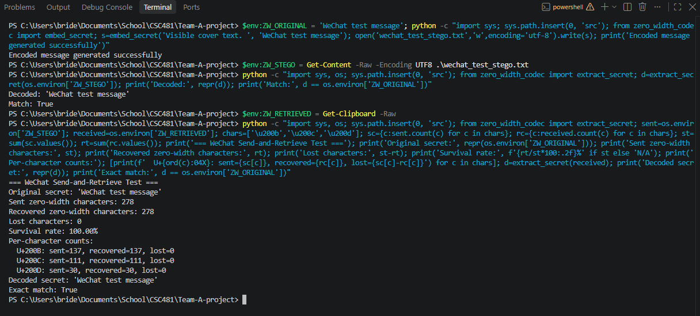
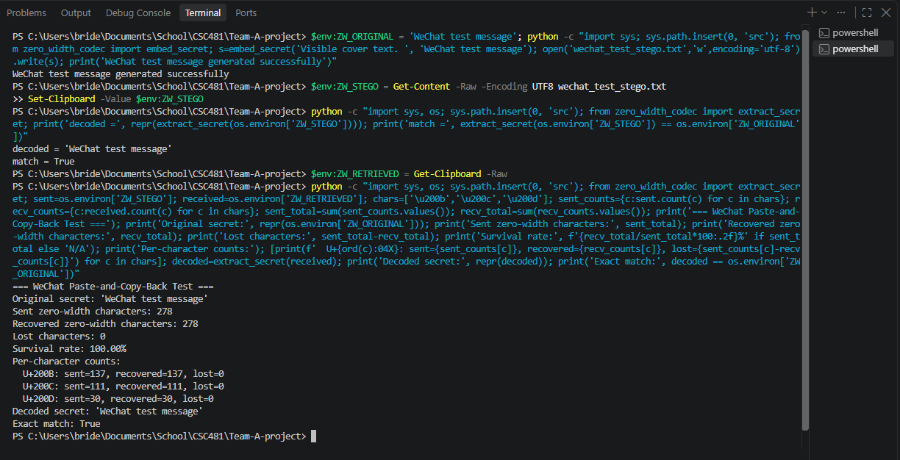

# Preliminary WeChat Feasibility Testing

## 1. Purpose and Overview

Preliminary feasibility checks were conducted using WeChat Desktop version 4.1.15.12 to determine whether zero-width Unicode characters could survive two proposed platform operations: paste-and-copy-back and send-and-retrieve. These tests were intended to establish whether WeChat was a suitable candidate for inclusion in the project's cross-platform testing matrix before official production testing began.

Both tests used the original secret message `WeChat test message`. The encoded text was transferred through WeChat using the relevant operation, after which the recovered text was examined for zero-width character retention and decoded using the project's zero-width steganography codec.

Both operations retained all 278 zero-width characters and successfully recovered the exact original secret. The results suggest that WeChat Desktop is a viable candidate for both proposed testing operations. These findings remain preliminary and are kept separate from the official production dataset until the testing protocol and assignments are finalized.

## 2. Test 1 - Send and Retrieve Test

### Testing Procedure

The encoded message containing the secret `WeChat test message` was sent through WeChat Desktop using the send-and-retrieve workflow. After the message was delivered, the delivered text was retrieved and examined using the project's testing tools. The number of recovered zero-width characters was compared with the number originally sent, and the recovered text was decoded to determine whether the original secret could be recovered exactly.

### Results

| Measurement | Result |
|---|---:|
| Original secret | `WeChat test message` |
| Zero-width characters sent | 278 |
| Zero-width characters recovered | 278 |
| Characters lost | 0 |
| Character survival rate | 100.00% |
| Decoder result | Successful |
| Exact match with original secret | Yes (`True`) |

#### Per-character results

| Unicode character | Sent | Recovered | Lost |
|---|---:|---:|---:|
| U+200B — Zero Width Space | 137 | 137 | 0 |
| U+200C — Zero Width Non-Joiner | 111 | 111 | 0 |
| U+200D — Zero Width Joiner | 30 | 30 | 0 |
| **Total** | **278** | **278** | **0** |

### Interpretation

The send-and-retrieve test achieved 100.00% zero-width character retention. All three types of zero-width characters were recovered in their original counts, and decoding returned the exact original secret. No character loss was observed during this preliminary transfer.

These results indicate that sending and retrieving a message through WeChat Desktop did not interfere with the encoded payload in this particular test. Additional testing is needed to determine whether the same behavior holds across different messages, repeated trials, and the finalized production corpus.

**Evidence:** `screenshots/tristan/WeChat_Send-and-Retrieve-Test-Results.png`

## 3. Test 2 — Paste-and-Copy-Back

### Testing Procedure

The encoded message containing the secret `WeChat test message` was pasted into the WeChat Desktop message editor and then copied back without sending it. The recovered text was examined using the project's testing tools. The recovered zero-width character counts were compared with the original counts, and the payload was decoded to verify whether the original secret remained intact.

### Results

| Measurement | Result |
|---|---:|
| Original secret | `WeChat test message` |
| Zero-width characters sent | 278 |
| Zero-width characters recovered | 278 |
| Characters lost | 0 |
| Character survival rate | 100.00% |
| Decoder result | Successful |
| Exact match with original secret | Yes (`True`) |

#### Per-character results

| Unicode character | Sent | Recovered | Lost |
|---|---:|---:|---:|
| U+200B — Zero Width Space | 137 | 137 | 0 |
| U+200C — Zero Width Non-Joiner | 111 | 111 | 0 |
| U+200D — Zero Width Joiner | 30 | 30 | 0 |
| **Total** | **278** | **278** | **0** |

### Interpretation

The paste-and-copy-back test also achieved 100.00% zero-width character retention. The counts for U+200B, U+200C, and U+200D were unchanged after the text was pasted into and copied back from the message editor. The recovered payload decoded successfully to the exact original secret.

This result suggests that WeChat Desktop's message editor preserved the encoded payload during the tested paste-and-copy-back operation. As with the send-and-retrieve test, further trials are required before drawing broader conclusions about WeChat's reliability across different messages and testing conditions.

**Evidence:** `screenshots/tristan/WeChat_Paste-and-Copy-Back_Test-Result.png`

## 4. Overall Findings

Both preliminary WeChat feasibility tests produced identical results: all 278 zero-width characters were recovered, no character loss was recorded, and the original secret was recovered exactly.

| Operation | Characters Sent | Characters Recovered | Survival Rate | Exact Recovery |
|---|---:|---:|---:|---|
| Send-and-retrieve | 278 | 278 | 100.00% | Pass |
| Paste-and-copy-back | 278 | 278 | 100.00% | Pass |

The findings support retaining WeChat Desktop version 4.1.15.12 as a candidate platform for both operations in the project's testing matrix. They also provide an initial indication that WeChat may preserve zero-width steganographic payloads during these specific workflows.

However, these results represent only one preliminary test of each operation using the same secret message. They do not establish performance across the full test corpus, repeated production trials, other WeChat versions, or different operating environments. The two tests should therefore be treated as feasibility evidence rather than as a representative measure of production reliability.

## 5. Data Status and Next Steps

These results are preliminary feasibility findings and must remain separate from the official production dataset. Production testing will begin only after the team has finalized the testing protocol, approved the platform-operation workflows, and confirmed individual testing assignments.

Once those decisions are confirmed, WeChat can be evaluated further if it remains part of the approved testing matrix. The production trials should use the agreed corpus, repeat counts, trial-record fields, and evidence requirements so that results can be compared consistently across platforms and operations.