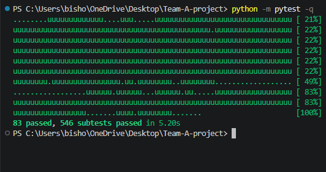

# Week 14 Individual Journal — Ifeanyi Emeka

**Course:** CS481 Capstone Project  
**Reporting Period:** November 16–22, 2026  
**Role:** Team Leader  
**Project:** Zero-Width Unicode Steganography with Error Correction

## 1. Weekly Objectives

My objectives for Week 14 were to coordinate the team’s remaining development work, review contributions before integration, and verify the project through automated testing. I also worked on documenting the results and preparing the material we would need for the final report and presentation.

## 2. Work Completed

### Monday Team Meeting — November 16

I conducted the Monday meeting with Henry Smith and Tristan Koch. All three team members were present. We identified code completion, integration testing, and documentation as our immediate priorities. After the meeting, I prepared the minutes, committed them to the repository, and confirmed that they were pushed to GitHub.

### Review and Integration

I independently reviewed Henry’s Week 14 contribution, which included code-quality updates, automated tests, documentation, and a codec verification script. When the new testing files were unavailable on my local branch, I fetched the remote branch and reviewed the changes separately. I ran the verification script before merging the contribution into the main branch and then ran the full regression suite on the integrated project.

### Friday Team Meeting — November 20

Henry, Tristan, and I attended the Friday meeting. We reviewed the work completed during the week and discussed the team’s progress as we approached the final deliverables.

### Week 14 Documentation

I organized the Week 14 progress report and updated my individual journal to document my review, integration, and testing work. I recorded the regression results by run and identified which result the screenshot supports.

## 3. Testing and Verification

### Targeted Codec Verification

I ran Henry’s verification script as part of my review before merging his contribution. All five checks passed. The script verified backward compatibility for both the baseline and repetition modes, a Unicode round trip in Hamming mode, correction of a single-bit error, and detection of a double-bit error. The project documentation identifies deleted or stripped zero-width symbols as outside the correction capability of Hamming mode.

### Automated Regression Testing

I used `python -m pytest -q` to run the automated regression suite. I completed an independent run earlier in the week, reran the suite after integrating Henry’s work, and completed a final local rerun to confirm the post-integration totals.

| Regression run | Tests passed | Subtests passed | Runtime |
| --- | ---: | ---: | ---: |
| Earlier independent Week 14 run | 83 | 546 | 5.20 seconds |
| Post-integration run | 87 | 549 | 5.01 seconds |
| Final local verification rerun | 87 | 549 | 5.30 seconds |

All three runs completed with no reported failures. The final local rerun reproduced the post-integration totals of 87 passing tests and 549 passing subtests.

*Figure 1. My earlier independent regression run passed 83 tests and 546 subtests in 5.20 seconds.*

## 4. Challenges and Lessons Learned

The main challenge was accessing the new verification files. They were unavailable on my local branch when I started the review. Fetching the remote branch gave me access to the files and allowed me to review and test the contribution before merging it.

The targeted checks helped me verify the codec behaviors covered by Henry’s contribution. The full regression runs then gave me a broader check of the integrated project. I also learned to document each run with its timing and purpose so that a reader can connect the reported totals to the correct evidence.

## 5. Leadership and Team Coordination

I used Monday’s meeting to establish the team’s priorities and Friday’s meeting to review the work completed during the week. Between meetings, I coordinated integration and documentation, reviewed Henry’s contribution, and recorded the verification results for the team report. All three team members attended both meetings.

## 6. Progress Compared With the Plan

Week 14 moved the project from Week 13 compatibility testing and statistical analysis into code-quality review, integration, and regression verification. I completed my review of Henry’s contribution, integrated it into the main branch, and verified the resulting project through the automated suite. The verified results and documented codec limitations are ready to support the final report and presentation.

## 7. Next Steps

- Confirm that the Friday meeting minutes are available in the repository.
- Verify that the regression screenshot displays correctly in the GitHub versions of the report and journal.
- Confirm each team member’s Week 14 deliverables against the repository records before finalizing the team report.
- Use the verified results and documented limitations to prepare the final report and presentation.

## 8. Personal Reflection

Leading the team this week meant following through on the work we agreed to on Monday and making sure we could explain what we had verified by Friday. Reviewing Henry’s contribution before merging it and rerunning the suite afterward gave me confidence in the results I reported. As we finish the project, my responsibility is to make sure the final report accurately reflects each team member’s work and gives readers enough evidence to understand our conclusions.